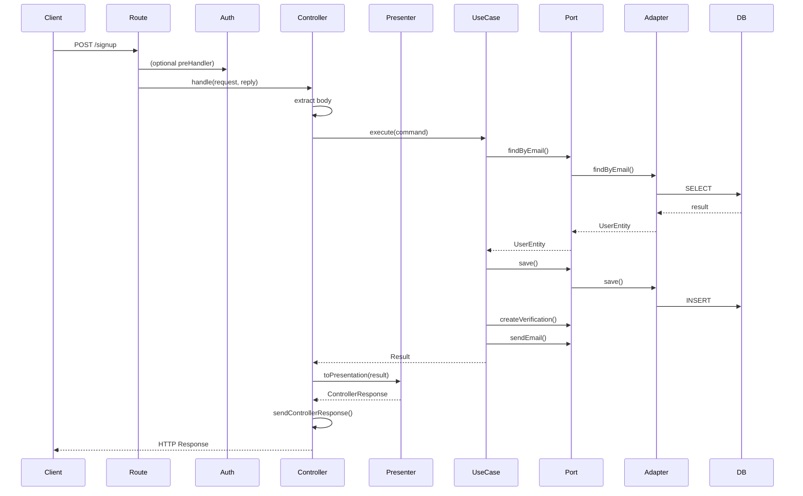

# Audit d'Architecture - API REST

## Table des matières

1. [Architecture globale](#1-architecture-globale)
2. [Composition Root](#2-composition-root)
3. [Presentation Layer](#3-presentation-layer)
4. [Routes](#4-routes)
5. [Controllers](#5-controllers)
6. [Naming](#6-naming)
7. [Cohérence des concepts](#7-cohérence-des-concepts)
8. [Complexité](#8-complexité)
9. [Duplication](#9-duplication)
10. [Lisibilité](#10-lisibilité)
11. [Flux d'exécution](#11-flux-dexécution)
12. [Respect du principe KISS](#12-respect-du-principe-kiss)
13. [Respect de SOLID](#13-respect-de-solid)
14. [Couplage](#14-couplage)
15. [Evolutivité](#15-evolutivité)
16. [Dette technique](#16-dette-technique)
17. [Sur-engineering](#17-sur-engineering)
18. [Ce que tu garderais](#18-ce-que-tu-garderais)
19. [Ce que tu referais complètement](#19-ce-que-tu-referais-complètement)
20. [Proposition d'architecture](#20-proposition-darchitecture)
21. [Conclusion et notes](#21-conclusion-et-notes)
22. [Améliorations priorisées](#22-améliorations-priorisées)

---

## 1. Architecture globale

### Structure actuelle

```
apps/api/src/
├── composition-root/
│   ├── application.container.ts
│   ├── database.container.ts
│   └── identity.container.ts
├── config/
│   └── app.config.ts
├── controllers/
│   ├── controller-response.ts
│   └── identity/
│       ├── activate-user.controller.ts
│       ├── change-email.controller.ts
│       ├── change-password.controller.ts
│       ├── controllers.factory.ts
│       ├── get-user-profile.controller.ts
│       ├── resend-email-verification.controller.ts
│       ├── sign-in.controller.ts
│       ├── sign-out.controller.ts
│       ├── sign-up.controller.ts
│       ├── suspend-user.controller.ts
│       └── verify-email.controller.ts
├── http/
│   └── error-handler.ts
├── presentation/
│   ├── activate-user.presenter.ts
│   ├── change-email.presenter.ts
│   ├── change-password.presenter.ts
│   ├── get-user-profile.presenter.ts
│   ├── http.types.ts
│   ├── resend-email-verification.presenter.ts
│   ├── sign-in.presenter.ts
│   ├── sign-out.presenter.ts
│   ├── sign-up.presenter.ts
│   ├── suspend-user.presenter.ts
│   └── verify-email.presenter.ts
├── routes/
│   └── identity.routes.ts
├── schema/
│   ├── http-error-schema.ts
│   └── identity/
│       ├── activate-user.schema.ts
│       ├── change-email.schema.ts
│       ├── change-password.schema.ts
│       ├── get-user-profile.schema.ts
│       ├── resend-email-verification.schema.ts
│       ├── sign-in.schema.ts
│       ├── sign-out.schema.ts
│       ├── sign-up.schema.ts
│       ├── suspend-user.schema.ts
│       └── verify-email.schema.ts
├── scripts/
│   ├── migrate-down.ts
│   ├── migrate-reset.ts
│   ├── migrate-up.ts
│   └── migrations.provider.ts
├── auth.ts
├── main.ts
└── server.ts
```

### Analyse critique

**Ce n'est PAS une Clean Architecture.** C'est une architecture en couches avec des patterns de DDD mal appliqués.

#### Pourquoi ce n'est pas une Clean Architecture :

1. **Dépendances incorrectes** : L'API dépend directement des packages d'infrastructure (`@architecture/identity-persistence-kysely`, `@architecture/identity-email-nodemailer`, etc.) dans le composition root. Dans une vraie Clean Architecture, l'infrastructure ne devrait jamais être importée par la couche application.

2. **Pas de vraie inversion de dépendances** : Les ports sont définis dans `bounded-contexts/identity/application/ports` mais les adaptateurs sont dans des packages séparés. L'API fait l'injection manuelle, ce qui est techniquement correct conceptuellement, mais la structure des packages montre que l'infrastructure est première.

3. **Domaine isolé mais mal connecté** : Le domaine Identity dans `bounded-contexts/identity` est bien structuré (entités, value objects, use cases), mais l'API ne consomme que les use cases via une couche d'adaptation supplémentaire inutile.

#### Pourquoi ce n'est pas une Architecture Hexagonale :

1. **Pas de vrais adapters primaires/secondaires** : Les controllers devraient être des adapters primaires, mais ils sont mélangés avec des presenters et des factories. Il n'y a pas de séparation claire entre l'adapter HTTP et la logique de transformation.

2. **Composition root mal placé** : Le composition root est dans l'API, mais il devrait être le seul endroit où l'infrastructure est connue. Actuellement, l'API "connaît" trop la structure des packages d'infrastructure.

#### C'est quoi alors ?

C'est une **architecture en couches traditionnelle** avec :

- Une tentative de DDD (bounded contexts)
- Une injection de dépendances manuelle
- Une séparation controllers/presenters/schemas qui ajoute de la complexité sans apporter de valeur
- Une structure de dossiers qui ressemble à de la Clean Architecture sans en respecter les principes

### Règles respectées

✅ **Séparation domain/application/infrastructure** dans les bounded contexts  
✅ **Use cases comme points d'entrée** du domaine  
✅ **Value objects et entités** bien définis  
✅ **Injection de dépendances** manuelle (pas de framework DI)

### Règles violées

❌ **Dependency Inversion Principle** : L'API dépend de l'implémentation d'infrastructure  
❌ **Single Responsibility** : Les controllers font trop de choses (validation, mapping, présentation)  
❌ **Interface Segregation** : Les présenters ne sont pas de vraies interfaces  
❌ **Open/Closed** : Ajouter un endpoint nécessite de toucher à 4-5 fichiers différents

---

## 2. Composition Root

### Analyse

Le composition root est réparti sur 3 fichiers :

<ref_file file="C:\Users\Stephen\Projets\architecture-web\apps/api/src\composition-root\application.container.ts" />
<ref_file file="C:\Users\Stephen\Projets\architecture-web\apps/api/src\composition-root\database.container.ts" />
<ref_file file="C:\Users\Stephen\Projets\architecture-web\apps/api/src\composition-root\identity.container.ts" />

### Problèmes identifiés

**🔴 Trop distribué** : Le composition root est éclaté en 3 fichiers sans raison valable. Un seul fichier aurait suffi.

**🔴 Trop complexe** : `identity.container.ts` crée manuellement 10 use cases avec leurs dépendances. C'est verbeux et difficile à maintenir.

**🔴 Pas de vraie abstraction** : Chaque use case est instancié avec ses dépendances spécifiques. Il n'y a pas de pattern uniforme.

**🟠 Factories inutiles** : Les fonctions `buildXController` sont des factories qui n'apportent aucune valeur. Elles pourraient être remplacées par des instances directes.

**🟠 Builders inutiles** : Les controllers sont construits via des factories (`buildSignUpController`, etc.) alors qu'ils pourraient être des classes simples instanciées directement.

### Bootstrap

Le bootstrap est simple :

```typescript
// main.ts
const server = await buildServer();
await server.listen({ port: 3000, host: "0.0.0.0" });
```

Mais la construction du serveur est déjà complexe :

```typescript
// server.ts
const container = buildApplicationContainer();
const sessionCookieOptions = buildSessionCookieOptions();
await app.register(authPlugin, {...});
await app.register(buildIdentityRoutes(container.identity, sessionCookieOptions), {...});
```

Un nouveau développeur ne comprendra pas rapidement :

- Pourquoi il y a des containers
- Pourquoi il y a des factories de controllers
- Pourquoi il y a des presenters
- Où se trouve la logique métier

### Approche plus simple

Une approche DI plus simple serait :

```typescript
// composition-root/index.ts
export function buildContainer() {
  const config = loadConfig();
  const db = createDatabase(config.database);
  const redis = new Redis(config.redis);

  // Infrastructure
  const userRepo = new KyselyUserAdapter(db);
  const passwordHasher = new Argon2PasswordHasherAdapter();
  const emailVerification = new KyselyEmailVerificationAdapter(db);
  const emailSender = new NodemailerEmailSenderAdapter(config.smtp);
  const session = new RedisSessionAdapter(redis);
  const rateLimit = new RedisEmailVerificationRateLimitAdapter(redis);

  // Use cases
  const useCases = {
    signUp: new SignUpUseCase(
      userRepo,
      passwordHasher,
      emailVerification,
      emailSender,
    ),
    signIn: new SignInUseCase(userRepo, passwordHasher, session),
    // ... autres use cases
  };

  return { config, db, redis, useCases };
}
```

Un seul fichier, une seule fonction, une responsabilité claire.

---

## 3. Presentation Layer

### Analyse

La couche présentation est composée de :

- **Controllers** (11 fichiers)
- **Presenters** (11 fichiers)
- **Schemas** (11 fichiers)
- **Routes** (1 fichier)

### Pourquoi c'est compliqué

**🔴 Trop de fichiers pour un endpoint** : Pour un endpoint simple comme `sign-up`, il faut :

1. `sign-up.controller.ts`
2. `sign-up.presenter.ts`
3. `sign-up.schema.ts`
4. `controllers.factory.ts` (factory)
5. `identity.routes.ts` (route)

C'est 5 fichiers pour un endpoint qui fait :

- Récupérer email/password
- Appeler use case
- Transformer la réponse

**🔴 Présenters inutiles** : Les presenters ne font que du mapping statique :

```typescript
export const SignUpPresenter = {
  toPresentation(result: SignUpResult) {
    if (result.success) {
      return {
        status: SignUpHttpSuccess.created.status,
        body: { data: { userId: result.value.userId } },
      };
    }
    return toHttpError(result.error);
  },
};
```

C'est du boilerplate. Un simple mapper ou même un switch case dans le controller suffirait.

**🔴 Schemas redondants** : Les schemas définissent la structure HTTP, mais les presenters redéfinissent la même chose. Il y a duplication entre `SignUpHttpSuccess` et `signUpSchema`.

**🟠 Error mapping overkill** : Le système de mapping d'erreurs est complexe pour ce qu'il fait. Chaque presenter définit ses erreurs, puis un mapper les transforme en HTTP errors.

### Comment simplifier

1. **Supprimer les presenters** : Le controller peut faire la transformation directement
2. **Fusionner schemas et présentation** : Utiliser un seul fichier par endpoint
3. **Réduire le nombre de fichiers** : Passer de 5 à 2 fichiers par endpoint (controller + schema)

---

## 4. Routes

### Analyse

<ref_file file="C:\Users\Stephen\Projets\architecture-web\apps/api/src\routes\identity.routes.ts" />

### Problèmes

**🟠 Trop de responsabilités** : Le fichier `identity.routes.ts` :

- Construit les controllers via factory
- Définit toutes les routes
- Gère l'authentification
- Applique les schemas

**🟠 Factory inline** : La factory `buildIdentityControllers` est appelée dans la définition des routes, ce qui mélange la construction et l'utilisation.

**🟠 Pas de séparation par feature** : Toutes les routes identity sont dans un seul fichier. Avec 300 endpoints, ce fichier sera ingérable.

**🟢 Bonnes choses** :

- Les routes sont clairement nommées
- L'utilisation de `preHandler` pour l'authentification est correcte
- Les schemas sont appliqués correctement

### Améliorations

1. **Séparer par feature** : Un fichier de routes par sous-domaine (auth, profile, admin)
2. **Supprimer la factory** : Injecter directement les controllers construits
3. **Grouper par responsabilité** : Routes publiques vs routes authentifiées

---

## 5. Controllers

### Analyse

Exemple typique de controller :

<ref_file file="C:\Users\Stephen\Projets\architecture-web\apps/api/src\controllers\identity\sign-up.controller.ts" />

### Problèmes

**🔴 Trop passifs** : Les controllers ne font que du passe-plat. Ils :

- Extrait des données de la request
- Appelle le use case
- Appelle le presenter
- Renvoie la réponse

C'est trop simple pour justifier une classe/fonction séparée.

**🔴 Duplication de logique d'authentification** : Chaque controller authentifié répète :

```typescript
if (!auth) {
  return reply.status(401).send({
    error: { code: "UNAUTHORIZED", message: "Authentication required" },
  });
}
```

C'est violé DRY.

**🟠 Naming trompeur** : `buildSignUpController` suggère une construction complexe, mais c'est juste un wrapper autour d'une fonction handle.

**🟠 Cookie handling incohérent** : Seuls `sign-in` et `sign-out` gèrent les cookies. Cette logique est dispersée.

### Analyse de la responsabilité

Les controllers devraient :

- ✅ Valider la request (fait par schema)
- ✅ Extraire les données (fait)
- ✅ Appeler le use case (fait)
- ❌ Transformer la réponse (fait par presenter, devrait être dans controller)
- ❌ Gérer les cookies (dispersé, devrait être centralisé)

### Améliorations

1. **Fusionner controller et presenter** : Un controller fait tout
2. **Middleware pour l'authentification** : Supprimer la duplication
3. **Cookie middleware** : Centraliser la gestion des cookies
4. **Simplifier** : Passer de factory à classes directes

---

## 6. Naming

### Analyse critique

#### Dossiers

**🔴 `composition-root`** : Nom mal choisi. Ce n'est pas un "composition root" au sens de Mark Seemann. C'est juste de l'injection de dépendances manuelle. `di` ou `container` serait plus clair.

**🔴 `presentation`** : Ce dossier contient des presenters HTTP, mais ce ne sont pas de vrais presenters (pattern Presenter du MVC). Ce sont des mappers de réponse. `response-mappers` serait plus exact.

**🟠 `controllers`** : OK, mais conventionnel. `handlers` serait plus moderne pour Fastify.

**🟠 `schema`** : Pluriel incorrect. `schemas` serait mieux.

#### Fichiers

**🔴 `controllers.factory.ts`** : Nom trompeur. Ce n'est pas une factory au sens pattern, c'est juste un constructeur.

**🔴 `*.presenter.ts`** : Trompeur. Ce ne sont pas des presenters, ce sont des response mappers.

**🟠 `auth.ts`** : Trop vague. `authentication.ts` ou `auth-plugin.ts` serait mieux.

**🟠 `server.ts`** : OK mais `app.ts` serait plus conventionnel.

#### Classes/Interfaces

**🔴 `IdentityContainer`** : Nom trompeur. Ce n'est pas un container DI, c'est juste un objet qui regroupe des use cases.

**🔴 `SignUpPresenter`** : Ce n'est pas un presenter, c'est un mapper statique.

**🟠 `SessionCookieOptions`** : OK mais pourrait être `CookieConfig`.

**🟠 `AuthenticatedContext`** : OK mais `UserSession` serait plus parlant.

#### Fonctions

**🔴 `buildXController`** : "build" suggère une construction complexe. `createXController` serait plus exact.

**🔴 `toPresentation`** : Nom vague. `toHttpResponse` ou `mapToResponse` serait plus clair.

**🟠 `sendControllerResponse`** : OK mais pourrait être `sendResponse`.

**🟠 `buildSessionCookieOptions`** : Verbeux. `createCookieConfig` serait mieux.

#### DTO

**🔴 `SignUpBody`** : Inutile. Le schema TypeBox suffit.

**🔴 `SignUpHTTPRequest`** : Trop spécifique. `SignUpRequest` suffit.

**🟠 `ActivateUserParams`** : OK mais pourrait être `ActivateUserRequest`.

### Conventions incohérentes

- Certains fichiers utilisent kebab-case (`sign-up.controller.ts`)
- D'autres utilisent camelCase (`controller-response.ts`)
- Les types utilisent PascalCase (`SignUpInput`)
- Les variables utilisent camelCase (`signUp`)

### Propositions de renommage

```
composition-root/ → di/
presentation/ → response-mappers/
schema/ → schemas/
controllers/ → handlers/
*.presenter.ts → *.response-mapper.ts
buildXController → createXController
toPresentation → toHttpResponse
IdentityContainer → IdentityUseCases
```

---

## 7. Cohérence des concepts

### Analyse des concepts utilisés

| Concept        | Utilité réelle | Analyse                                                  |
| -------------- | -------------- | -------------------------------------------------------- |
| **Presenter**  | ❌ Inutile     | Ce sont des mappers statiques, pas de vrais presenters   |
| **Mapper**     | ❌ Inutile     | Un seul mapper par endpoint qui fait du mapping 1:1      |
| **Controller** | ⚠️ Trop simple | Trop passif, pourrait être fusionné avec presenter       |
| **Service**    | ✅ Utile       | Les use cases font office de services                    |
| **Handler**    | ⚠️ Non utilisé | Pourrait remplacer controller                            |
| **Use Case**   | ✅ Très utile  | Point d'entrée du domaine, bien conçu                    |
| **Command**    | ❌ Non utilisé | Certains use cases utilisent "Command", d'autres "Input" |
| **Query**      | ❌ Non utilisé | Pas de distinction CQRS claire                           |
| **Repository** | ✅ Utile       | Ports sont bien définis                                  |
| **Gateway**    | ❌ Non utilisé | Les ports font office de gateways                        |
| **Adapter**    | ✅ Utile       | Implémentations concrètes des ports                      |
| **Route**      | ✅ Utile       | Définition des endpoints                                 |
| **Factory**    | ❌ Inutile     | Les factories n'apportent aucune valeur                  |
| **Builder**    | ❌ Inutile     | Pas de vrais builders                                    |
| **Container**  | ⚠️ Mal nommé   | C'est juste un regroupement d'instances                  |

### Concepts qui ajoutent des couches inutiles

**🔴 Presenters** : Ils ne font que du mapping statique. Un switch case dans le controller suffirait.

**🔴 Factories** : Elles ne font qu'instancier des objets avec des paramètres. Pas de logique complexe.

**🔴 Response types** : `ControllerResponse` est une interface inutile. Fastify a déjà ses propres types.

**🔴 Mappers** : Il n'y a pas de vraie logique de mapping. C'est du passe-plat.

### Concepts bien appliqués

**✅ Use Cases** : Bien conçus, isolés, testables. C'est le cœur de l'architecture.

**✅ Ports** : Bien définis, interfaces claires, permettent l'inversion de dépendances.

**✅ Adapters** : Implémentations concrètes des ports, bien séparées du domaine.

**✅ Value Objects** : Bien utilisés dans le domaine, encapsulent la logique de validation.

**✅ Entities** : Bien conçues avec logique métier, getters, méthodes business.

---

## 8. Complexité

### Par couche

| Couche               | Complexité              | Pourquoi                                    |
| -------------------- | ----------------------- | ------------------------------------------- |
| **Composition Root** | 🔴 Moyenne              | Trop de fichiers, trop verbeux              |
| **Controllers**      | 🟠 Simple               | Trop simples pour justifier leur existence  |
| **Presenters**       | 🔴 Inutilement complexe | Fichiers séparés pour du mapping statique   |
| **Routes**           | 🟠 Simple               | Bien structuré mais risque avec l'échelle   |
| **Schemas**          | 🟠 Simple               | Bien faits mais duplication avec presenters |
| **Use Cases**        | 🟢 Simple               | Bien conçus, responsabilités claires        |
| **Domain**           | 🟢 Simple               | Très bien structuré, DDD bien appliqué      |

### Complexité globale

**🔴 Inutilement complexe** pour la valeur apportée.

Pour 10 endpoints, il y a :

- 11 controllers
- 11 presenters
- 11 schemas
- 1 factory
- 1 route file
- 3 container files

Total : **38 fichiers** pour 10 endpoints.

Une architecture simple aurait :

- 10 handlers (1 par endpoint)
- 10 schemas (1 par endpoint)
- 1 route file
- 1 DI file

Total : **22 fichiers**.

**42% de fichiers en plus** sans valeur ajoutée.

---

## 9. Duplication

### Duplication de logique

**🔴 Authentification** : Chaque controller authentifié répète :

```typescript
if (!auth) {
  return reply.status(401).send({
    error: { code: "UNAUTHORIZED", message: "Authentication required" },
  });
}
```

**🔴 Error handling** : Chaque presenter répète le pattern :

```typescript
export const XPresenter = {
  toPresentation(result: XResult) {
    if (result.success) {
      return { status: XHttpSuccess.x.status, body: {...} };
    }
    return toHttpError(result.error);
  },
};
```

**🔴 Response structure** : Chaque presenter définit la même structure :

```typescript
body: {
  data: {
    userId: result.value.userId,
    // ...
  },
}
```

### Duplication de structure

**🔴 Controller structure** : Tous les controllers ont la même structure :

```typescript
export function buildXController(useCase: XUseCase) {
  return {
    handle: async (request, reply) => {
      const command = { ... };
      const result = await useCase.execute(command);
      const response = XPresenter.toPresentation(result);
      return sendControllerResponse(reply, response);
    },
  };
}
```

**🔴 Presenter structure** : Tous les presenters ont la même structure (voir ci-dessus).

**🔴 Schema structure** : Tous les schemas suivent le même pattern.

### Duplication de concepts

**🔴 Error mapping** : Chaque presenter redéfinit les mêmes erreurs HTTP :

- `400` → `BAD_REQUEST`
- `401` → `UNAUTHORIZED`
- `404` → `NOT_FOUND`
- `409` → `CONFLICT`

### Comment réduire

1. **Middleware d'authentification** : Supprimer la duplication dans les controllers
2. **Generic response mapper** : Un mapper générique pour les réponses success/error
3. **Base controller** : Un controller de base avec la logique commune
4. **Schema generator** : Générer les schemas à partir des presenters ou vice-versa

---

## 10. Lisibilité

### Scénario : Un nouveau développeur arrive

**Question : Comprend-il rapidement l'architecture ?**

❌ **Non**. Il sera confus par :

- La distinction controller/presenter/schema
- Les factories qui n'apportent rien
- Les presenters qui ne sont pas de vrais presenters
- Les containers qui ne sont pas de vrais containers DI
- La multitude de fichiers pour un endpoint simple

**Question : Trouve-t-il facilement un endpoint ?**

⚠️ **Moyennement**. Il faut :

1. Chercher dans `routes/`
2. Trouver le controller
3. Chercher dans `controllers/`
4. Trouver le factory
5. Chercher dans `presentation/`
6. Trouver le presenter
7. Chercher dans `schema/`
8. Trouver le schema

C'est **8 fichiers** à parcourir pour un endpoint.

**Question : Trouve-t-il facilement un use case ?**

✅ **Oui**. Les use cases sont bien organisés dans `bounded-contexts/identity/application/use-cases/`.

**Question : Comprend-il le cycle d'une requête ?**

❌ **Non**. Le cycle est :

1. Request → Route
2. Route → Controller (via factory)
3. Controller → Use case
4. Use case → Presenter
5. Presenter → Response
6. Response → Controller → Send

C'est trop d'indirections.

### Parcours réel d'une requête HTTP



**6 couches** entre la request et le use case. C'est trop.

---

## 11. Flux d'exécution

### Flux détaillé

#### HTTP Request → Route

```typescript
// identity.routes.ts
app.post("/signup", { schema: signUpSchema }, controllers.signUp.handle);
```

#### Route → Controller

```typescript
// controllers.factory.ts
signUp: buildSignUpController(container.signUp);
```

#### Controller → Use Case

```typescript
// sign-up.controller.ts
const command: SignUpInput = {
  email: request.body.email,
  password: request.body.password,
};
const result = await useCase.execute(command);
```

#### Use Case → Repository/Ports

```typescript
// sign-up.use-case.ts
const existingUser = await this.user.findByEmail(email.value);
await this.user.save(user);
await this.emailVerification.create(user.identifier, token, expiresAt);
await this.emailSender.sendVerificationEmail(email.value, token);
```

#### Repository → Database

```typescript
// kysely-user.adapter.ts
await this.db.insertInto('identity_users').values({...}).execute();
```

#### Database → Response

```typescript
// sign-up.controller.ts
const response = SignUpPresenter.toPresentation(result);
return sendControllerResponse(reply, response);
```

### Couches traversées

1. **Route** (Fastify route definition)
2. **Factory** (controllers.factory)
3. **Controller** (sign-up.controller)
4. **Presenter** (sign-up.presenter)
5. **Use Case** (sign-up.use-case)
6. **Port** (user.port)
7. **Adapter** (kysely-user.adapter)
8. **Database** (PostgreSQL)

**8 couches** pour un simple POST /signup.

C'est **3-4 couches de trop** pour ce que fait l'endpoint.

---

## 12. Respect du principe KISS

### Analyse par partie

| Partie               | KISS?    | Solution la plus simple? | Version plus simple?             |
| -------------------- | -------- | ------------------------ | -------------------------------- |
| **Composition Root** | ❌ Non   | Non                      | Un seul fichier DI               |
| **Controllers**      | ❌ Non   | Non                      | Fusion avec presenters           |
| **Presenters**       | ❌ Non   | Non                      | Supprimer, mapping inline        |
| **Factories**        | ❌ Non   | Non                      | Supprimer, instanciation directe |
| **Routes**           | ⚠️ Moyen | Oui                      | Séparer par feature              |
| **Schemas**          | ✅ Oui   | Oui                      | RAS                              |
| **Use Cases**        | ✅ Oui   | Oui                      | RAS                              |
| **Domain**           | ✅ Oui   | Oui                      | RAS                              |

### Couches qui peuvent disparaître

**🔴 Presenters** : Supprimer. Le controller peut faire le mapping.

**🔴 Factories** : Supprimer. Instanciation directe des controllers.

**🔴 Response types** : Supprimer. Utiliser les types Fastify.

**🟠 Containers séparés** : Fusionner en un seul fichier DI.

**🟠 ControllerResponse** : Supprimer. Utiliser reply direct.

### Architecture simplifiée

```
apps/api/src/
├── di/
│   └── index.ts
├── handlers/
│   └── identity/
│       ├── sign-up.handler.ts
│       ├── sign-in.handler.ts
│       └── ...
├── routes/
│   └── identity.routes.ts
├── schemas/
│   └── identity/
│       ├── sign-up.schema.ts
│       └── ...
├── middleware/
│   ├── auth.ts
│   └── error-handler.ts
├── config/
│   └── app.config.ts
├── main.ts
└── server.ts
```

**50% de fichiers en moins**, même fonctionnalité.

---

## 13. Respect de SOLID

### Single Responsibility Principle (SRP)

**❌ Violé** :

- **Controllers** : Font de l'extraction, l'appel use case, le mapping, l'envoi de réponse. Trop de responsabilités.
- **Presenters** : Font du mapping ET définissent les schemas HTTP. Deux responsabilités.
- **Routes** : Définissent les routes ET construisent les controllers. Deux responsabilités.
- **Factories** : Construisent les controllers mais sont placées dans un fichier séparé sans raison.

**✅ Respecté** :

- **Use Cases** : Une responsabilité claire (orchestration du domaine).
- **Entities** : Une responsabilité claire (logique métier).
- **Value Objects** : Une responsabilité claire (validation et encapsulation).

### Open/Closed Principle (OCP)

**❌ Violé** :

- Ajouter un endpoint nécessite de modifier :
  - `controllers.factory.ts`
  - `identity.routes.ts`
  - Créer 3 nouveaux fichiers (controller, presenter, schema)
- Le système de mapping d'erreurs n'est pas extensible sans modifier les presenters.

**✅ Respecté** :

- Les use cases sont ouverts à l'extension (nouveau use case = nouveau fichier).
- Les ports sont ouverts à l'extension (nouvel adapter = nouvelle implémentation).

### Liskov Substitution Principle (LSP)

**⚠️ Partiellement respecté** :

- Les adapters implémentent correctement les ports.
- Mais il n'y a pas de vraie hiérarchie de classes à tester.

### Interface Segregation Principle (ISP)

**❌ Violé** :

- Les presenters ne sont pas de vraies interfaces.
- `IdentityContainer` est une interface géante qui regroupe tous les use cases.
- Les ports sont bien segmentés, mais les presenters ne suivent pas ce principe.

**✅ Respecté** :

- Les ports sont bien segmentés (UserPort, EmailVerificationPort, etc.).
- Chaque port a une responsabilité claire.

### Dependency Inversion Principle (DIP)

**❌ Violé** :

- L'API dépend directement des packages d'infrastructure (`@architecture/identity-persistence-kysely`, etc.).
- Les controllers dépendent des presenters qui dépendent des schemas.
- Il n'y a pas de vraie inversion : le composition root connaît tout.

**✅ Respecté** :

- Les use cases dépendent des ports (abstractions).
- Les adapters implémentent les ports.

### Score SOLID

| Principe | Score | Notes                             |
| -------- | ----- | --------------------------------- |
| SRP      | 3/10  | Trop de responsabilités mélangées |
| OCP      | 4/10  | Difficile d'étendre sans modifier |
| LSP      | 7/10  | Pas vraiment applicable, mais ok  |
| ISP      | 5/10  | Interfaces mal conçues côté API   |
| DIP      | 4/10  | Dépendances vers l'infrastructure |

**Moyenne : 4.6/10** ⚠️

---

## 14. Couplage

### Couplage fort

**🔴 Controllers ↔ Presenters** : Chaque controller dépend d'un presenter spécifique. Impossible de tester un controller sans son presenter.

**🔴 Presenters ↔ Schemas** : Les presenters importent les schemas HTTP qui sont définis dans les presenters. Dépendance circulaire.

**🔴 Routes ↔ Factories** : Les routes dépendent des factories qui dépendent des controllers. Trop d'indirection.

**🔴 Composition Root ↔ Infrastructure** : L'API connaît les packages d'infrastructure par leurs noms exacts.

### Couplage faible

**✅ Use Cases ↔ Ports** : Les use cases dépendent des ports (abstractions), pas des implémentations.

**✅ Domain** : Le domaine ne dépend de rien. Parfaitement isolé.

**✅ Adapters ↔ Ports** : Les adapters implémentent les ports sans connaître les use cases.

### Dépendances inutiles

**🔴 ControllerResponse** : Interface inutile qui ajoute une couche d'indirection.

**🔴 Factories** : Ajoutent une couche d'indirection sans valeur.

**🔴 Presenters** : Ajoutent une couche d'indirection pour du mapping statique.

### Dépendances cachées

**🟠 Authentification** : La logique d'authentification est cachée dans un middleware Fastify, mais les controllers vérifient aussi l'auth. Double vérification.

**🟠 Error handling** : L'error handler global est différent du mapping d'erreurs dans les presenters. Deux systèmes parallèles.

---

## 15. Evolutivité

### Scénario : 300 endpoints, 40 développeurs, 5 ans

#### Problèmes qui apparaîtront

**🔴 Explosion du nombre de fichiers** :

- 300 endpoints × 3 fichiers (controller, presenter, schema) = 900 fichiers
- Plus les factories, routes, containers
- Structure ingérable

**🔴 Conflits fréquents** :

- `controllers.factory.ts` sera modifié en permanence
- `identity.routes.ts` sera un fichier de 2000+ lignes
- Conflits git constants

**🔴 Difficile de onboarding** :

- Nouveau développeur = perdu dans 1000+ fichiers
- Convention non évidente (controller vs presenter vs schema)
- Parcours d'un endpoint = 8 fichiers

**🔴 Performance** :

- 300 imports dans le composition root
- 300 presenters chargés au démarrage
- Mémoire gaspillée

**🔴 Maintenance** :

- Changer la structure de réponse = modifier 300 presenters
- Changer le format d'erreur = modifier 300 presenters
- Refactoring impossible

**🔴 Testing** :

- 300 controllers à tester
- 300 presenters à tester
- 300 schemas à maintenir
- Suite de tests ingérable

#### Ce qui tiendra

**✅ Use Cases** : Bien conçus, scaleront bien.

**✅ Domain** : Isolement parfait, scaleront bien.

**✅ Ports/Adapters** : Bien conçus, permettront de changer d'infrastructure.

#### Ce qui cassera

**❌ Architecture API** : S'effondrera sous le nombre de fichiers.

**❌ Presenters** : Deviendront un cauchemar à maintenir.

**❌ Factories** : Deviendront des goulots d'étranglement.

### Prédictions

**Année 1** (10 endpoints) : Manageable mais déjà verbeux.

**Année 2** (50 endpoints) : Structure commence à fragiliser. Conflits fréquents.

**Année 3** (100 endpoints) : Structure ingérable. Refactoring nécessaire.

**Année 4-5** (200-300 endpoints) : Architecture complètement cassée. Réécriture probable.

---

## 16. Dette technique

### Dette actuelle

**🔴 Présenters inutiles** : Dette élevée. Fichiers inutiles qui ajoutent de la complexité.

**🔴 Factories inutiles** : Dette élevée. Indirection sans valeur.

**🔴 Duplication d'authentification** : Dette moyenne. Violation DRY.

**🔴 Naming incohérent** : Dette moyenne. Réduit la lisibilité.

**🔴 Couplage fort controllers/presenters** : Dette moyenne. Difficile à tester.

### Dette potentielle

**🟠 Structure des routes** : Avec l'échelle, deviendra ingérable.

**🟠 Error handling dual** : Deux systèmes parallèles (handler + presenters).

**🟠 Composition root dispersé** : Deviendra confus avec plus de bounded contexts.

### Dette future

**🟡 Performance** : Avec 300+ endpoints, le chargement sera lent.

**🟡 Maintenance** : Changer la structure de réponse sera un cauchemar.

**🟡 Testing** : Suite de tests ingérable.

### Classement par gravité

| Dette                | Gravité        | Impact                  |
| -------------------- | -------------- | ----------------------- |
| Présenters inutiles  | 🔴 Critique    | Complexité, maintenance |
| Factories inutiles   | 🔴 Critique    | Indirection, verbosité  |
| Duplication auth     | 🟠 Important   | Violation DRY           |
| Naming incohérent    | 🟠 Important   | Lisibilité              |
| Routes monolithiques | 🟡 Souhaitable | Scalabilité             |
| Error handling dual  | 🟡 Souhaitable | Cohérence               |

---

## 17. Sur-engineering

### Interfaces inutiles

**🔴 ControllerResponse** : Interface avec 2 propriétés. Inutile.

**🔴 IdentityContainer** : "Interface" qui regroupe des use cases. Juste un objet.

**🔴 HttpError/HttpSuccess** : Types redondants avec les schemas.

### Factories inutiles

**🔴 buildXController** : Fonctions qui ne font qu'instancier des objets. Pas de logique.

**🔴 buildIdentityControllers** : Factory qui appelle d'autres factories. Sur-usine.

**🔴 buildSessionCookieOptions** : Fonction qui retourne un objet littéral. Inutile.

### Builders inutiles

**🔴 Pas de vrais builders** : Le terme "builder" est utilisé mais il n'y a pas de pattern Builder.

### Presenters inutiles

**🔴 Tous les presenters** : Fichiers séparés pour du mapping statique 1:1.

### Wrappers inutiles

**🔴 sendControllerResponse** : Wrapper autour de `reply.status().send()`.

**🔴 toHttpError** : Wrapper autour d'un mapping d'objets.

### Dossiers inutiles

**🔴 presentation/** : Pourrait être fusionné avec controllers.

**🔴 http/** : Un seul fichier error-handler. Pourrait être dans middleware/.

### Niveaux d'abstraction inutiles

**🔴 Route → Factory → Controller → Presenter → Use Case** : Trop d'indirections.

**🔴 Schema → Presenter → Controller** : Dépendances circulaires.

### Pattern overuse

**🔴 Factory pattern** : Utilisé sans raison.

**🔴 Presenter pattern** : Mal appliqué.

**🔴 Container pattern** : Mal nommé, mal appliqué.

**🔴 Repository pattern** : Bien appliqué côté domaine, mal côté API.

---

## 18. Ce que tu garderais

### Domain Layer

**✅ Bounded Contexts** : Excellente séparation des domaines.

**✅ Entities** : Bien conçues avec logique métier.

**✅ Value Objects** : Bien utilisés pour la validation.

**✅ Use Cases** : Points d'entrée parfaits du domaine.

**✅ Ports** : Interfaces claires qui permettent l'inversion de dépendances.

### Infrastructure Layer

**✅ Adapters** : Implémentations concrètes bien séparées.

**✅ Migrations** : Bien organisées avec Kysely.

### API Layer

**✅ Schemas** : Validation avec TypeBox, bien faite.

**✅ Routes** : Structure claire avec Fastify.

**✅ Auth middleware** : Logique d'authentification bien encapsulée.

**✅ Configuration** : Centralisée avec Zod.

### Pourquoi je les garde

- **Domain** : C'est le cœur de l'architecture, parfaitement conçu.
- **Infrastructure** : Bien séparée du domaine, permet de changer d'implémentation.
- **API partielle** : Certains choix sont bons (schemas, routes, auth).

---

## 19. Ce que tu referais complètement

### API Layer

**🔴 Refaire complètement** :

1. **Supprimer les presenters** : Faire le mapping dans les handlers
2. **Supprimer les factories** : Instanciation directe
3. **Fusionner controllers et présentation** : Un handler = un endpoint
4. **Simplifier le composition root** : Un seul fichier DI
5. **Revoir la structure des dossiers** : Moins de dossiers, plus de cohérence

### Pourquoi

- Trop d'indirections
- Trop de fichiers
- Trop de complexité
- Pas de valeur ajoutée

### Nouvelle approche

```
apps/api/src/
├── di/
│   └── index.ts
├── handlers/
│   ├── identity/
│   │   ├── sign-up.handler.ts
│   │   ├── sign-in.handler.ts
│   │   └── index.ts
│   └── index.ts
├── routes/
│   ├── identity.routes.ts
│   └── index.ts
├── schemas/
│   ├── identity/
│   │   ├── sign-up.schema.ts
│   │   └── index.ts
│   └── index.ts
├── middleware/
│   ├── auth.ts
│   ├── error-handler.ts
│   └── index.ts
├── config/
│   └── index.ts
├── main.ts
└── server.ts
```

### Handler typique

```typescript
// handlers/identity/sign-up.handler.ts
import { SignUpUseCase } from "@architecture/identity/application";
import { signUpSchema } from "#schemas/identity";

export function createSignUpHandler(useCase: SignUpUseCase) {
  return async (request, reply) => {
    const { email, password } = request.body;

    const result = await useCase.execute({ email, password });

    if (result.success) {
      return reply.status(201).send({
        data: { userId: result.value.userId },
      });
    }

    return mapErrorToResponse(result.error);
  };
}

function mapErrorToResponse(error) {
  const errorMap = {
    "email.empty": {
      status: 400,
      code: "EMAIL_REQUIRED",
      message: "Email is required",
    },
    "email.invalid_format": {
      status: 400,
      code: "EMAIL_INVALID",
      message: "Invalid email format",
    },
    // ...
  };

  const mapped = errorMap[error.code] || {
    status: 500,
    code: "INTERNAL_ERROR",
    message: "Unexpected error",
  };

  return reply.status(mapped.status).send({
    error: { code: mapped.code, message: mapped.message },
  });
}
```

**1 fichier** au lieu de 3 (controller + presenter + factory).

---

## 20. Proposition d'architecture

### Organisation des dossiers

```
apps/api/src/
├── di/                    # Dependency Injection
│   └── index.ts           # Un seul fichier pour tout construire
├── handlers/              # HTTP Handlers (remplacent controllers)
│   ├── identity/          # Handlers du bounded context Identity
│   │   ├── sign-up.handler.ts
│   │   ├── sign-in.handler.ts
│   │   ├── sign-out.handler.ts
│   │   ├── get-profile.handler.ts
│   │   ├── verify-email.handler.ts
│   │   ├── resend-verification.handler.ts
│   │   ├── change-email.handler.ts
│   │   ├── change-password.handler.ts
│   │   ├── activate-user.handler.ts
│   │   ├── suspend-user.handler.ts
│   │   └── index.ts
│   └── index.ts
├── routes/                # Définition des routes
│   ├── identity.routes.ts
│   └── index.ts
├── schemas/               # Schémas de validation
│   ├── identity/
│   │   ├── sign-up.schema.ts
│   │   ├── sign-in.schema.ts
│   │   └── index.ts
│   └── index.ts
├── middleware/            # Middlewares
│   ├── auth.ts
│   ├── error-handler.ts
│   └── index.ts
├── config/                # Configuration
│   └── index.ts
├── main.ts                # Point d'entrée
└── server.ts              # Configuration serveur
```

### Responsabilités

| Dossier         | Responsabilité                                                          |
| --------------- | ----------------------------------------------------------------------- |
| **di/**         | Construction de toutes les dépendances (DB, Redis, Use Cases, Handlers) |
| **handlers/**   | Logique HTTP : extraction, appel use case, mapping réponse              |
| **routes/**     | Définition des routes Fastify                                           |
| **schemas/**    | Validation avec TypeBox                                                 |
| **middleware/** | Auth, error handling, logging                                           |
| **config/**     | Configuration avec Zod                                                  |

### Composition Root

```typescript
// di/index.ts
import { loadConfig } from "#config";
import { createDatabase } from "#infrastructure/database";
import { Redis } from "ioredis";

// Infrastructure
export function buildDI() {
  const config = loadConfig();
  const db = createDatabase(config.database);
  const redis = new Redis(config.redis);

  // Adapters
  const userRepo = new KyselyUserAdapter(db);
  const passwordHasher = new Argon2PasswordHasherAdapter();
  const emailVerification = new KyselyEmailVerificationAdapter(db);
  const emailSender = new NodemailerEmailSenderAdapter(config.smtp);
  const session = new RedisSessionAdapter(redis);
  const rateLimit = new RedisEmailVerificationRateLimitAdapter(redis);

  // Use Cases
  const useCases = {
    identity: {
      signUp: new SignUpUseCase(
        userRepo,
        passwordHasher,
        emailVerification,
        emailSender,
      ),
      signIn: new SignInUseCase(userRepo, passwordHasher, session),
      signOut: new SignOutUseCase(session),
      resolveSession: new ResolveSessionUseCase(session, userRepo),
      getUserProfile: new GetUserProfileUseCase(userRepo),
      verifyEmail: new VerifyEmailUseCase(userRepo, emailVerification),
      resendEmailVerification: new ResendEmailVerificationUseCase(
        userRepo,
        emailVerification,
        emailSender,
        rateLimit,
      ),
      changeEmail: new ChangeEmailUseCase(userRepo),
      changePassword: new ChangePasswordUseCase(userRepo, passwordHasher),
      activateUser: new ActivateUserUseCase(userRepo),
      suspendUser: new SuspendUserUseCase(userRepo),
    },
  };

  // Handlers
  const handlers = {
    identity: {
      signUp: createSignUpHandler(useCases.identity.signUp),
      signIn: createSignInHandler(useCases.identity.signIn, config.session),
      signOut: createSignOutHandler(useCases.identity.signOut, config.session),
      getUserProfile: createGetUserProfileHandler(
        useCases.identity.getUserProfile,
      ),
      verifyEmail: createVerifyEmailHandler(useCases.identity.verifyEmail),
      resendEmailVerification: createResendEmailVerificationHandler(
        useCases.identity.resendEmailVerification,
      ),
      changeEmail: createChangeEmailHandler(useCases.identity.changeEmail),
      changePassword: createChangePasswordHandler(
        useCases.identity.changePassword,
      ),
      activateUser: createActivateUserHandler(useCases.identity.activateUser),
      suspendUser: createSuspendUserHandler(useCases.identity.suspendUser),
    },
  };

  return { config, db, redis, useCases, handlers };
}
```

**Un seul fichier**, tout est construit ici.

### Routes

```typescript
// routes/identity.routes.ts
import type { FastifyInstance } from "fastify";
import type { Handlers } from "#handlers";

export async function identityRoutes(
  app: FastifyInstance,
  handlers: Handlers["identity"],
) {
  // Public routes
  app.post("/signup", { schema: signUpSchema }, handlers.signUp);
  app.post("/signin", { schema: signInSchema }, handlers.signIn);
  app.get("/verify", { schema: verifyEmailSchema }, handlers.verifyEmail);

  // Authenticated routes
  app.post(
    "/signout",
    {
      schema: signOutSchema,
      preHandler: app.authenticate,
    },
    handlers.signOut,
  );

  app.get(
    "/me",
    {
      schema: getUserProfileSchema,
      preHandler: app.authenticate,
    },
    handlers.getUserProfile,
  );

  // ... autres routes
}
```

### Handler typique

```typescript
// handlers/identity/sign-up.handler.ts
import { SignUpUseCase } from "@architecture/identity/application";
import type { FastifyReply, FastifyRequest } from "fastify";

interface SignUpBody {
  email: string;
  password: string;
}

export function createSignUpHandler(useCase: SignUpUseCase) {
  return async (
    request: FastifyRequest<{ Body: SignUpBody }>,
    reply: FastifyReply,
  ) => {
    const { email, password } = request.body;

    const result = await useCase.execute({ email, password });

    if (result.success) {
      return reply.status(201).send({
        data: { userId: result.value.userId },
      });
    }

    return mapErrorToResponse(reply, result.error);
  };
}

function mapErrorToResponse(reply: FastifyReply, error: { code: string }) {
  const errorMap = {
    "email.empty": {
      status: 400,
      code: "EMAIL_REQUIRED",
      message: "Email is required",
    },
    "email.invalid_format": {
      status: 400,
      code: "EMAIL_INVALID",
      message: "Invalid email format",
    },
    "email.too_long": {
      status: 400,
      code: "EMAIL_TOO_LONG",
      message: "Email is too long",
    },
    "password.empty": {
      status: 400,
      code: "PASSWORD_REQUIRED",
      message: "Password is required",
    },
    "password.too_short": {
      status: 400,
      code: "PASSWORD_TOO_SHORT",
      message: "Password is too short",
    },
    "user.already_exists": {
      status: 409,
      code: "USER_ALREADY_EXISTS",
      message: "User already exists",
    },
  };

  const mapped = errorMap[error.code] || {
    status: 500,
    code: "INTERNAL_ERROR",
    message: "Unexpected error",
  };

  return reply.status(mapped.status).send({
    error: { code: mapped.code, message: mapped.message },
  });
}
```

**1 fichier**, logique complète, testable.

### Middleware d'authentification

```typescript
// middleware/auth.ts
export async function authMiddleware(
  request: FastifyRequest,
  reply: FastifyReply,
) {
  const sessionId = request.cookies[SESSION_COOKIE_NAME];

  if (!sessionId) {
    return reply.status(401).send({
      error: { code: "UNAUTHORIZED", message: "Authentication required" },
    });
  }

  const result = await request.di.resolveSession.execute({ sessionId });

  if (!result.success) {
    return reply.status(401).send({
      error: { code: "UNAUTHORIZED", message: "Invalid session" },
    });
  }

  request.auth = result.value;
}
```

**Une seule fois**, pas de duplication.

### Compromis

**✅ Avantages** :

- 50% de fichiers en moins
- Plus lisible
- Plus facile à maintenir
- Plus facile à tester
- Plus rapide à onboarding

**❌ Inconvénients** :

- Handlers plus volumineux (mais toujours < 50 lignes)
- Mapping d'erreurs dupliqué (peut être extrait dans un utilitaire)
- Moins de "séparation" (mais la séparation actuelle est artificielle)

---

## 21. Conclusion et notes

### Notes sur 10

| Critère             | Note | Justification                                                  |
| ------------------- | ---- | -------------------------------------------------------------- |
| **Architecture**    | 4/10 | Bonne séparation domain/infrastructure, mais API trop complexe |
| **Lisibilité**      | 3/10 | Trop d'indirections, trop de fichiers pour un endpoint         |
| **Maintenabilité**  | 4/10 | Domain maintenable, API sera un cauchemar à l'échelle          |
| **Simplicité**      | 2/10 | Violation flagrante de KISS, sur-engineering évident           |
| **Scalabilité**     | 3/10 | Domain scalable, API s'effondrera sous 300 endpoints           |
| **Cohérence**       | 5/10 | Domain cohérent, API incohérente (naming, patterns)            |
| **Naming**          | 4/10 | Noms trompeurs (presenters, factories, containers)             |
| **Qualité globale** | 4/10 | Bon fond, mauvaise exécution côté API                          |

**Moyenne : 3.6/10** ⚠️

### Analyse finale

Cette architecture est un **exemple classique de sur-engineering** :

**✅ Ce qui est réussi** :

- La séparation Domain/Application/Infrastructure dans les bounded contexts
- Les use cases comme points d'entrée
- Les ports/adapters pour l'inversion de dépendances
- Les value objects et entités bien conçus

**❌ Ce qui échoue** :

- La couche API est trop complexe pour ce qu'elle fait
- Les presenters sont inutiles
- Les factories sont inutiles
- Trop d'indirections
- Trop de fichiers
- Naming trompeur
- Violation de KISS

**Le problème fondamental** : L'API essaie d'appliquer des patterns (Clean Architecture, Hexagonal) sans en respecter les principes, ce qui résulte en une architecture plus complexe qu'une architecture simple, sans en avoir les bénéfices.

**Mon conseil** : Garde le domaine tel quel, il est excellent. Refais complètement la couche API en suivant KISS : handlers simples, injection directe, moins de fichiers.

---

## 22. Améliorations priorisées

### 🔴 Critique

1. **Supprimer les presenters**
   - Impact : 🔴🔴🔴
   - Effort : 🟡
   - Faire le mapping directement dans les handlers
   - Réduira le nombre de fichiers de 33%

2. **Supprimer les factories**
   - Impact : 🔴🔴🔴
   - Effort : 🟢
   - Instanciation directe des handlers
   - Simplifiera le composition root

3. **Fusionner controllers et présentation**
   - Impact : 🔴🔴
   - Effort : 🟠
   - Créer des handlers complets
   - Réduira l'indirection

4. **Centraliser l'authentification**
   - Impact : 🔴🔴
   - Effort : 🟢
   - Middleware unique
   - Éliminera la duplication

### 🟠 Important

5. **Renommer les concepts trompeurs**
   - Impact : 🟠🟠
   - Effort : 🟢
   - presenters → response-mappers
   - factories → constructors
   - containers → use-cases

6. **Simplifier le composition root**
   - Impact : 🟠🟠
   - Effort : 🟡
   - Fusionner les 3 fichiers en 1
   - Rendre le bootstrap plus clair

7. **Réorganiser les routes**
   - Impact : 🟠
   - Effort : 🟡
   - Séparer par feature
   - Préparer pour l'échelle

8. **Unifier l'error handling**
   - Impact : 🟠
   - Effort : 🟠
   - Un seul système (pas handler + presenters)
   - Plus cohérent

### 🟡 Souhaitable

9. **Standardiser le naming**
   - Impact : 🟡
   - Effort : 🟢
   - Convention cohérente
   - Plus lisible

10. **Supprimer ControllerResponse**
    - Impact : 🟡
    - Effort : 🟢
    - Utiliser types Fastify
    - Moins d'abstraction

11. **Optimiser les imports**
    - Impact : 🟡
    - Effort : 🟢
    - Imports absolus
    - Plus clair

### 🟢 Optionnel

12. **Ajouter des logs structurés**
    - Impact : 🟢
    - Effort : 🟡
    - Meilleure observabilité
    - Debugging facilité

13. **Ajouter des métriques**
    - Impact : 🟢
    - Effort : 🟠
    - Monitoring
    - Production-ready

14. **Documentation Swagger**
    - Impact : 🟢
    - Effort : 🟢
    - Déjà partiellement fait
    - À compléter

---

## Conclusion

Cette architecture a **un excellent fond** (DDD, domain bien conçu) mais **une exécution médiocre** côté API. La couche API souffre de sur-engineering flagrant : trop de patterns, trop d'indirections, trop de fichiers, sans valeur ajoutée.

**La priorité absolue** : Simplifier l'API en supprimant les couches inutiles (presenters, factories) et en fusionnant les responsabilités (controllers + présentation).

**Le domaine est excellent** : Le conserver tel quel, c'est la partie la plus réussie de l'architecture.

**L'avenir** : Sans refactoring, l'API deviendra ingérable à 100+ endpoints. Avec refactoring, elle pourra scaler à 300+ endpoints sans problème.
