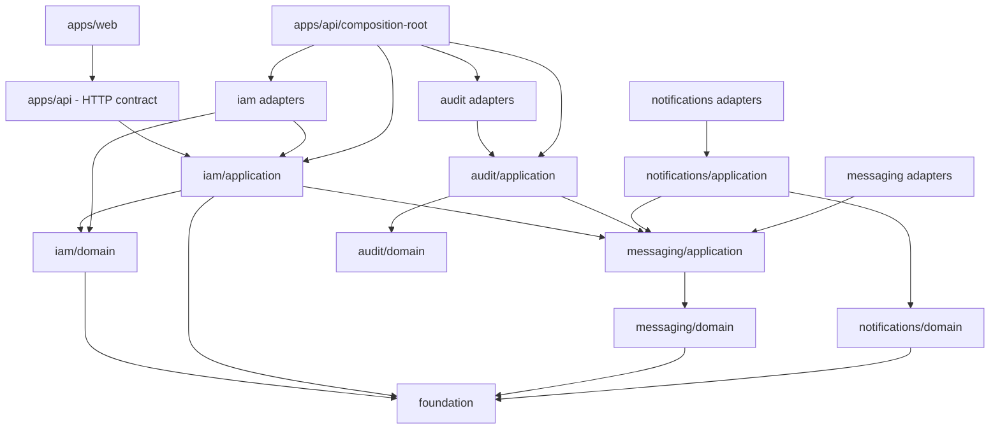

# Dependency rules

**MUST**, **MUST NOT**, **SHOULD**, and **MAY** are normative.

## Allowed direction



An arrow means “may depend on”; it does not require the dependency. Labels such
as `iam/application` describe architectural responsibility, not nested workspace
package paths; cohesive domain/application packages keep those layers below their
own `src/` directories.

## Matrix

| From                                         | May import                                     | Must not import                             |
| -------------------------------------------- | ---------------------------------------------- | ------------------------------------------- |
| Foundation                                   | required generic libraries                     | IAM, apps, infrastructure                   |
| IAM domain                                   | Foundation, IAM domain                         | application, infrastructure, Fastify, React |
| IAM application                              | IAM domain, Foundation, Messaging, local ports | adapters, database, cache, HTTP, UI         |
| Messaging domain                             | Foundation, Messaging model                    | application, Kysely, HTTP, UI               |
| Messaging application                        | Messaging domain, local ports                  | Kysely, HTTP, UI                            |
| Audit domain                                 | Audit domain                                   | application, Messaging, Kysely, HTTP, UI    |
| Audit application                            | Audit domain, Messaging, local ports           | adapters, Kysely, HTTP, UI                  |
| Notifications domain                         | Foundation, Notifications domain               | application, Messaging, Kysely, HTTP, UI    |
| Notifications application                    | Notifications domain, Messaging, local ports   | adapters, Kysely, HTTP, UI                  |
| IAM infrastructure                           | public IAM exports, targeted technology        | private core internals, apps                |
| Messaging/Audit/Notifications infrastructure | public core exports, targeted technology       | private internals, apps                     |
| API outside composition                      | application contracts, Fastify, API helpers    | domain internals, concrete adapters         |
| API composition root                         | application and concrete adapters              | —                                           |
| Web                                          | UI code and HTTP contract                      | business and infrastructure packages        |

IAM security routes follow the same boundary as other IAM transport. Node cryptography, mail, archives and cross-context bridges live under `apps/api/src/adapters`; concrete composition lives under `composition-root`.

## Direct answers

- An entity **MUST NOT** import a use case.
- An entity is defined by business identity and continuity; it **MAY** be
  transient or an aggregate child and therefore does not require a dedicated
  repository.
- A use case **MUST NOT** depend on Redis or Kysely.
- Infrastructure **MUST** depend on the application port it implements.
- A command repository **MUST** receive and save an aggregate root.
- A transaction spanning multiple aggregates **MUST** be controlled through an
  application port, never directly through Kysely in the use case.
- Business types shared by domain and application belong to the domain.
- Generic, truly cross-domain types **MAY** belong to Foundation.
- HTTP DTOs belong to `apps/api`; matching client types belong to `apps/web`.
- Business packages **MAY** depend on Foundation, but applications and adapters
  **SHOULD** prefer a closer contract when one exists.

## Exports and imports

External consumers **MUST** use exported subpaths:

```ts
import type { SignIn } from "@architecture/iam/application";
import { EmailValueObject } from "@architecture/iam/domain";
```

They **MUST NOT** import files inside
`packages/contexts/iam/src/application/<capability>/<use-case>`. Within a package,
declared `#...` aliases **SHOULD** replace `../` parent imports. The current
ESLint rule reports parent imports as warnings.

Internal package aliases omit `.js`; relative imports intended for ESM output
generally include `.js`.

## Port compatibility

An implementation **MUST**:

1. depend on the public port;
2. declare `implements Port`;
3. preserve semantics as well as the signature;
4. test important behavior and technical errors;
5. be selected only in the composition root.

Adding a required method, changing parameters, return values, or semantics is a
breaking port change. Every adapter and test double **MUST** change together.
Adding a required contract field, removing a code, or changing its meaning is
also breaking.

## Current enforcement and limitation

IAM ESLint presets reject application/technical imports in the domain and concrete database, cache, HTTP, crypto and provider dependencies in application code. API transport cannot import concrete IAM adapters or domain models; adapter and composition directories have explicit technical responsibilities. Tests verify both rejected and legitimate dependencies.

Package exports and TypeScript enforce public contracts. These targeted static rules do not resolve every possible dependency path or replace review against the complete matrix.
