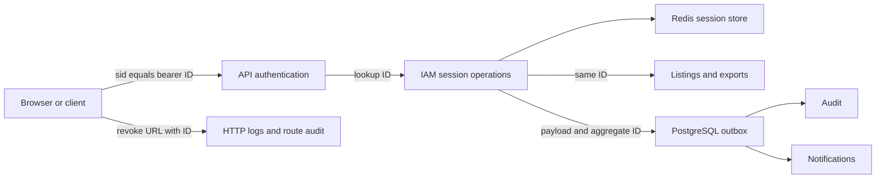
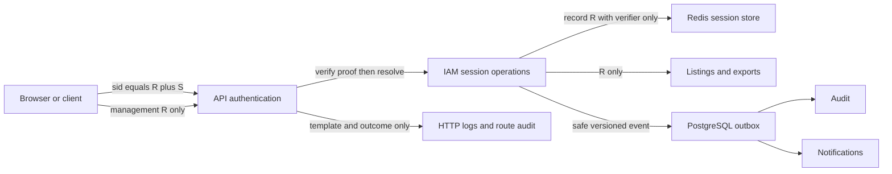
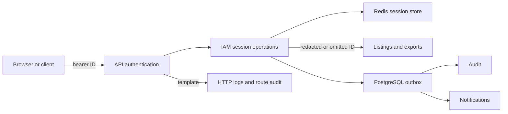
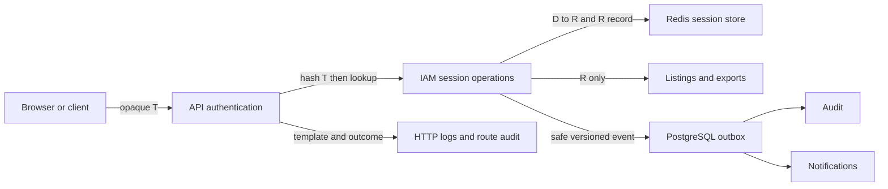

# Technical Design — Prevent session bearer credential disclosure

- **Work:** [Architecture Web #49](https://github.com/Oxelio/Architecture-Web/issues/49)
- **Artifact status:** Approved Target for Work #49 — scoped Software Architect design decision; not implemented
- **Content status:** Approved Target (single Technical Design owner; no implementation or Readiness authority)
- **Document type:** Technical Design
- **Domain:** IAM authentication, session management, Messaging, Audit, account export
- **Evidence date:** 19 October 2026, Europe/Paris
- **Implementation baseline:** `development` at `a3d09eafe7caafe6542c6832a67cc6f26f219de1`
**Adopted Method:** submodule gitlink `703051af50189a70399d82c82ca0f2b17c35f998`

## Work context

I inspected the latest development implementation, its relevant tests, the three functional owners, architecture owners and relevant ADRs, and the Method revision actually adopted by the repository. This Technical Design is the **Approved Target for Work #49** after Software Architect review of D2 and the existing architecture boundaries. The structural target was human-accepted in ADR-0008. Sign-out behavior was human-approved in [SF-SESSION-001](../specifications/SF-SESSION-001.md) and [Work #49](https://github.com/Oxelio/Architecture-Web/issues/49#issuecomment-6256658492). The implementation remains unchanged. Target acceptance does not establish Project Work State, Readiness, runtime security validation or authority for destructive local data cleanup.

**Classification recommendation:** Defect Correction / Complex. The primary intent restores established confidentiality requirements. Security, privacy, cross-system, compatibility, concurrency and operational migration characteristics apply. The selected mechanism also warrants a structural ADR; that does not silently reclassify or expand the Work into a general IAM redesign. Classification here is a recommendation, not a Project-field update.

**Role/activity:** Software Architect (Technical Design and design-level Architecture Review), followed by separate Technical Planner/Readiness activities. This design is an Approved Target, not a claim of implementation or formal Readiness.

**Operational context:** Issue #49 is readable. `.github/delivery-automation.json` marks Project-backed mappings verified and selects Oxelio Project #3. A live read of #49's Project item failed with `Resource not accessible by integration`. Work State, live Work Type, Workflow Depth and Priority are therefore unavailable; none is inferred from the Issue or this document. This does not prevent a requested read-only design proposal. It blocks claims about lifecycle position or a transition.

**Authority:** `AGENTS.md`; `docs/project/project-method-profile.md`; `docs/project/delivery-pipeline.md`; `docs/project/architecture-principles.md`; `docs/architecture/{overview,dependency-rules,packages}.md`; ADR register and ADR-0004 through ADR-0007; `docs/development/testing.md`; and the three Functional Specifications below. The full activity-scoped [Context Manifest](../explorations/iam/work-49-context.md) distinguishes owners, evidence and limitations.

### Accepted structural direction and approved technical target

We have three comparison options: **Option 1, contain exposure while retaining the existing bearer identity**; **Option 2, independent public reference plus opaque authentication token**; and **Option 3, public identifier plus independent secret in the authentication credential**. Option 1 is an insufficient baseline. Options 2 and 3 are viable if every affected boundary is changed together.

ADR-0008 establishes **Option 3** as the accepted structural target. This design specifies its reviewed D2 protocol in section 7 using `v2.<public-reference>.<random-secret>` and a bound verifier stored in Redis; the Work remains outside implementation until Readiness. We retain the UUID session identity for consultation and revocation, while possession of that identity conveys no authentication authority. The main advantage over Option 2 is a single authoritative Redis session record, with no reverse credential index to coordinate. The costs are a changed cookie format, breaking application/port semantics, coordinated deployment and explicit invalidation of legacy credentials. The protocol is an Approved Technical Design decision within ADR-0008's accepted structural boundaries; neither approval grants implementation Readiness.

### Evidence map

All source links below are pinned to the implementation baseline. “Observed” means source-inspected, not runtime reproduced. The inferred diagnosis is that one value currently carries both resource identity and authentication authority, so ordinary identity propagation also propagates a capability.

| Evidence | Source and what it establishes |
| --- | --- |
| E01 — Cookie equals session identity | Observed: [sign-in controller](https://github.com/Oxelio/Architecture-Web/blob/a3d09eafe7caafe6542c6832a67cc6f26f219de1/apps/api/src/features/iam/sign-in/sign-in.controller.ts#L45), [auth plugin](https://github.com/Oxelio/Architecture-Web/blob/a3d09eafe7caafe6542c6832a67cc6f26f219de1/apps/api/src/auth.ts#L59), and [resolver](https://github.com/Oxelio/Architecture-Web/blob/a3d09eafe7caafe6542c6832a67cc6f26f219de1/packages/iam/src/application/authentication/resolve-session/resolve-session.use-case.ts#L25): the cookie value is accepted as the lookup identity, without independent proof. |
| E02 — Session-management disclosure | Observed: `packages/iam/src/application/authentication/list-current-user-sessions/list-current-user-sessions.use-case.ts` and `access-administration/list-user-sessions/list-user-sessions.use-case.ts` expose `session.identifier.value`. `apps/web/src/components/SessionSummary.tsx` renders it. Both revoke use cases look it up and check ownership/administration. |
| E03 — Durable event and audit disclosure | Observed: [SessionStarted](https://github.com/Oxelio/Architecture-Web/blob/a3d09eafe7caafe6542c6832a67cc6f26f219de1/packages/iam/src/domain/events/iam-domain-events.ts#L117) places the value in both `aggregateId` and payload `sessionId`. `toIamIntegrationEvent` copies both, version 1. The Kysely outbox persists them. `AuditIntegrationEventHandler` passes payload into metadata. `packages/audit/src/domain/audit-redaction.policy.ts` does not match `sessionId`. |
| E04 — Two export paths | Observed: [export generation](https://github.com/Oxelio/Architecture-Web/blob/a3d09eafe7caafe6542c6832a67cc6f26f219de1/apps/api/src/security/security.service.ts#L1274) writes the identity to `sessions.json`; `security-events.json` includes exported Audit metadata. Audit read mapping uses the same insufficient key redaction. Ready ZIP bytes are stored in `iam_account_exports.archive`. |
| E05 — Secondary creation and authenticated consumers | Observed: [MFA completion](https://github.com/Oxelio/Architecture-Web/blob/a3d09eafe7caafe6542c6832a67cc6f26f219de1/apps/api/src/security/security.service.ts#L790) independently creates/saves a session; [MFA route](https://github.com/Oxelio/Architecture-Web/blob/a3d09eafe7caafe6542c6832a67cc6f26f219de1/apps/api/src/security/security.routes.ts#L87) sets its ID as cookie. `verifyRecentPassword` finds a session by authenticated ID for export, deletion and MFA operations. MFA completion currently does not append its pending `SessionStarted` event. |
| E06 — Redis lifecycle and concurrency | Observed: [Redis adapter](https://github.com/Oxelio/Architecture-Web/blob/a3d09eafe7caafe6542c6832a67cc6f26f219de1/packages/iam-session-redis/src/adapters/redis-session.adapter.ts) uses `session:<id>`, a per-user expiry-scored sorted set, atomic creation/maximum enforcement, and a separate read/`SET KEEPTTL` activity update. The latter can recreate a key deleted between GET and SET; no real Redis reproduction was run here. |
| E07 — Routes and operational logs | Observed: [server](https://github.com/Oxelio/Architecture-Web/blob/a3d09eafe7caafe6542c6832a67cc6f26f219de1/apps/api/src/server.ts#L78) puts the concrete request path in Audit metadata under `route`. A revoke URL therefore also carries the bearer value today. `logger: true` has no explicit credential redaction in this configuration; exact emitted runtime log content was not measured. |
| E08 — Notifications are a consumer, not a confirmed output leak | Observed: `packages/notifications/src/application/use-cases/notification-event-handler.use-case.ts` receives the integration envelope but persists static policy title/message/action URL and `sourceEventId`, not the session payload. Current delivery contents do not establish a session-secret disclosure; the input event is still contaminated. |
| E09 — Validation limits | Observed: Redis tests use mocked methods and assert script invocation, not real Lua execution. Current export/security tests cover primitives. `docs/development/testing.md` explicitly identifies missing PostgreSQL/Redis cross-boundary suites. No existing pass count is reused as validation for this proposal. |

## 1. Authorized behavior / constraints to preserve

We preserve the behavior owned by `docs/specifications/SF-SESSION-001.md`, `SF-SECURITY-AUDIT-001.md` and `SF-ACCOUNT-DATA-001.md`, rather than treating the present leak as a compatibility promise. SF-SESSION-001 has legacy maturity `Implementation`; the catalog says that is not a generic Work State and does not assert completed review/validation. The other two specifications are `Approved`. Their confidentiality requirements agree; no new Functional Specification is needed merely to separate identity from proof.

The relevant preservation obligations are owner/admin authorization, useful session metadata and current-session indication, explicit warning and logout when the user revokes the current session, authenticated cookie login, and secret-free audit/export. Optional metadata failures must not prevent session use. Existing activity throttling, expiry, session-count enforcement and user session-version invalidation are implementation/ADR constraints to preserve, not newly invented product rules.

SF-SESSION-001 explicitly calls for one strict Redis format without historical session-format support, based on the then stated absence of production deployment. The human project maintainer has since confirmed Architecture Web has **never been deployed**. This supports a strict v2-only development cutover without preserving deployed sessions; local Docker/Redis AOF, development/test data and ZIP artifacts still require a scoped inventory before destructive cleanup.

## 2. Bounded-context / responsibility ownership

IAM owns session identity, authentication proof semantics, ownership and lifecycle. Messaging owns durable delivery and retries, not credentials. Audit owns minimized security history and its redaction/read projections. Notifications owns notification content and delivery; it must not receive authentication proof. Account-export orchestration remains in the existing `SecurityService` for this bounded correction.

The API owns cookie transport, HTTP mapping, safe request logging and composition. Redis owns the concrete record, TTL and atomic scripts through an IAM application port. Cryptographic algorithms remain in an infrastructure adapter. We do not promote the existing `SecurityService` dependency exception into a rule, move the entire service, add another bounded context or introduce a distributed transaction.

## 3. Domain responsibilities and consistency boundaries

Keep `SessionEntity` as its own aggregate under ADR-0004. Its identifier becomes unambiguously a **public session reference**. We can retain the current UUIDv7 value object and management DTO field names, documenting their safe semantics. UUIDv7 exposes approximate creation ordering and remains personal/correlatable information; “non-secret” does not mean publicly enumerable or freely loggable.

The aggregate owns existing timestamps, user/session-version association and optional metadata. It records events containing safe identity, never a secret or verifier. A credential is a proof for the session, not a new domain aggregate. No hashing library, Redis schema or cookie grammar enters domain code. A digest is not put on the aggregate merely to make persistence convenient.

## 4. Application responsibilities / use cases

After password validation and, where required, successful MFA, application orchestration creates the session and issues its credential. Both creation paths must use the same proof capability and persistence protocol. The secret may be returned exactly once to the cookie-setting adapter; an entity read cannot recover it.

`ResolveSession` accepts the credential, parses it through the credential capability, loads the authentication-only record, verifies the secret, then performs the existing expiry, account and session-version checks. Only after proof verification may it produce `{userId, sessionId: publicReference, role}`. Current-session comparison, management use cases and `verifyRecentPassword` consume this authenticated reference. A reference parsed from an unverified cookie is never an authenticated context.

Own/admin listings remain explicit safe projections. Authorized revocation continues by public reference, with the existing ownership checks and errors. Recent-password and MFA checks remain in place for export/deletion; possession of a public reference alone does not satisfy them.

The public sign-out route deserves separate handling. Today it reads an unprotected cookie and deletes by its value. Under this proposal, it must verify proof before deleting a known session; otherwise anybody who knows a public reference could terminate that session. It need not reload account status just to forget a valid credential. Section 14 records the human-approved mapping for invalid and already absent proofs.

## 5. Ports and external capabilities

Propose one focused, application-owned `SessionCredentialProtection` capability for issuance, bounded parsing and verification. Its contracts distinguish an opaque sensitive credential, a validated reference and an opaque protected verifier. A Node cryptography implementation belongs in infrastructure, composed through `apps/api/src/composition-root`; the existing `apps/api/src/adapters` pattern can host it without a new workspace package. All core tests use a deterministic double. This is an explicit boundary for randomness and crypto, not a provider import in the use case.

Evolve `SessionRepository` so creation takes the aggregate plus its protected verifier, atomically stored together. Retain metadata-only `findById`/`findActiveForUser` reads; add an explicit authentication-only read returning `{session, verifier}`. The latter is used by resolve and sign-out, never listing/export/event mapping. `save` and `saveEnforcingMaximum` must both require a verifier; there is no default verifier and no alternate insecure save path. Credential records are immutable after issuance except for the existing activity update.

These are breaking port changes even if some management signatures remain unchanged. Update every adapter, factory, `SecurityService` dependency and test double together. A type alias or brand helps prevent mistakes but is not an information-flow security boundary; we still need positive DTO/event allowlists and disclosure tests.

## 6. Adapters and composition

Keep Fastify cookie name `sid`, `httpOnly`, path, expiry/max-age and environment-specific Secure/SameSite behavior. Controllers set the issued credential, not `sessionId`. Sign-in and MFA responses stay body-free on success as currently mapped; challenge responses still contain only their existing challenge fields.

Wire the same credential capability into IAM use cases and the existing MFA session-creation path. Both Redis adapter instances currently built by `application.module.ts` and `iam.module.ts` must use the new format. Add no provider choice to a product-facing configuration screen.

The adapter validates the persisted schema and strips authentication material from ordinary reads. A corrupt or incomplete record remains unusable; we do not silently manufacture missing fields. The HTTP adapter receives expected application failures; Redis/network/programming exceptions remain technical failures.

## 7. Data and state

For Option 3 we would use independently generated values:

- `R`: public UUIDv7 session reference, retaining the current identifier convention.
- `S`: 32 bytes from a cryptographically secure random generator, encoded as canonical unpadded base64url.
- `C`: `v2.R.S`, the bearer credential issued to the client.
- `V`: SHA-256 over an unambiguous, domain-separated encoding of version, canonical `R` and the decoded secret bytes. For example, UTF-8 `architecture-web/session/v2`, a NUL delimiter, canonical `R`, another NUL, then the 32 secret bytes. The algorithm is an adapter decision proposed here, not a business rule.

Hashing is appropriate for a uniformly random 256-bit secret. A password-strength KDF adds cost on every authenticated request without a meaningful advantage against exhaustive search of that space. HMAC with an independently managed pepper can be considered if the threat model requires an extra barrier against verifier disclosure, but creates key distribution, rotation and availability obligations. I do not recommend adding that dependency for this correction. Redis write compromise and API process compromise remain outside the protection supplied by a hash.

The cookie has exactly three bounded canonical components. Reject unknown versions, extra components, malformed UUIDs, wrong byte lengths and non-canonical encodings before an unbounded lookup or comparison. Compare fixed-size digest bytes in constant time. Neither `R`, `V`, `S` alone nor a stored verifier substituted for `S` authenticates. Binding `V` to `R` prevents taking a proof from one session and pairing it with another.

Proposed strict storage:

```text
iam:session:v2:<R> -> {
  schemaVersion: 2,
  userId, userSessionVersion,
  createdAt, lastActivityAt, expiresAt,
  credentialVerifier: V,
  client?, network?
} with an absolute expiry no later than expiresAt

iam:user-sessions:v2:<userId> -> sorted set (member R, score expiresAt)
```

Only the authentication read can return `V`. Ordinary entity/projection reads omit it. Redis keys and sorted-set members contain no secret or credential. The additional storage is one fixed-size digest and schema tag per session; there is no second per-session lookup key. An index may outlive individual records as in the current design; expired members and missing records must be cleaned without extending session lifetime. No raw secret is persisted in Redis/AOF, PostgreSQL, events or ZIPs.

### D2 — Protocol and Redis consistency decision (Software Architect review)

**Design resolution for Work #49:** adopt the following bounded technical contract as the implementation target, subordinate to the human-accepted structural rules of ADR-0008 and the approved functional behavior in SF-SESSION-001. This is a design decision, **not** a test result, Work State transition, or authorization to modify code before Readiness.

- **Credential generation/parsing:** use exactly `v2.<R>.<S>`. `R` is the existing lowercase, canonical UUIDv7 session reference; `S` is 32 independent CSPRNG bytes encoded as exactly 43 unpadded canonical base64url characters. Reject leading/trailing whitespace, uppercase/non-canonical UUID forms, padding, extra segments, unknown versions, malformed lengths and non-canonical re-encodings before accessing session storage. Decode `S` to bytes before deriving a verifier. Parsing fails with an expected invalid-credential outcome; credential contents never enter errors or telemetry.
- **Verifier and proof validation:** compute `V = SHA-256(domain || NUL || canonical-R || NUL || raw-32-byte-S)` for a versioned, unambiguous domain string. Store only `V`; no token, secret, or reversible derivative belongs in metadata reads, user indexes, events, Audit, ZIPs or logs. On an authentication-only read, enforce the expected schema, ownership/reference binding and absolute expiry before issuing authenticated context. Compare fixed-size digests with a constant-time primitive. A missing record, wrong proof, malformed credential and unsupported version all fail closed; do not let absence of a record or a parser exception silently turn into a technical failure when it is a normal invalid credential. Technical Redis/crypto failures remain technical errors. No legacy bare-UUID fallback.
- **Atomic creation and collision handling:** use an atomic Redis operation for record creation, user-index membership, expiry cleanup and maximum-session enforcement. Reject a reference collision (never overwrite a live record or rotate its proof) and retry with a newly generated reference and independent secret within a bounded policy. Do not create a credential when `expiresAt <= now`. The operation and user-index key must be co-located for standalone Redis; the supplied Compose configuration uses Redis 8.8.1, not Redis Cluster.
- **Absolute expiration:** enforce `expiresAt` against the application's explicit expiry and Redis key expiration, preferably using Redis absolute millisecond expiry (`PXAT`/`PEXPIREAT` where supported), not a rounded relative `EX` that can outlive the declared expiry. The user-index score uses that same absolute expiry. Authentication must deny a logically expired record even if Redis has not yet removed it. A touch or index cleanup must never extend expiry.
- **Atomic activity and deletion:** update activity only after proof verification; use a Redis script that checks record existence/schema/expiry, updates only `lastActivityAt`, advances it monotonically and keeps its prior absolute expiration. A delayed touch after revocation, expiration or eviction must do nothing; it must not recreate a key. Single-session revocation must delete the record and relevant index membership atomically for the targeted reference. `deleteAllForUser` must atomically remove the sessions visible at its own execution point and not be described as a barrier against new concurrent sign-ins. Preserve ADR-0004's user-session-version invalidation mechanism.
- **Read boundary:** `SessionRepository` keeps explicitly different authentication-only and safe metadata operations. The former may obtain an opaque fixed-size verifier for proof checking but never expose the credential; all listings and authorized reference-based revocation use verifier-free projections. The sensitive credential is returned only once on issuance to the cookie adapter. Do not let `SessionEntity` own cryptographic implementations.
- **Validation oracle:** real Redis 8.8.1 tests must cover collision, concurrent sign-in at the 10-session cap, expired-record rejection, cleanup of orphan index members, touch versus revocation/expiry interleavings, repeated deletion, absolute TTL, reject-old-schema, and failure injection. Static Vitest doubles cannot substitute for actual script execution. Exercise password and MFA issuance through the HTTP adapter and inspect outbox/Audit/export payloads using canary credentials.

**Security review limitations:** this resolution covers the proposed protocol and its consistency requirements. It does not prove cryptographic implementation correctness, Redis atomicity in code, non-exposure in logs, operator-disposable local data, or acceptable performance. Those remain explicit Validation/operational evidence obligations, not silently waived gates.

## 8. Flows, interfaces and contracts

We can preserve management wire shapes while changing the authority of their values. The required contract changes are explicit:

| Boundary | Proposed treatment | Compatibility consequence |
| --- | --- | --- |
| `AuthenticationSession` and MFA completion result | Separate `sessionId` reference and sensitive `sessionCredential`; return expiry as before. Only cookie adapter consumes credential. | Breaking required application field/semantic change. |
| `ResolveSessionInput`, `SignOutInput` | Name credential input explicitly; do not keep an ID-shaped input that accepts both semantics. | Breaking application API; update all consumers/doubles. |
| `SessionResolution` / `request.auth` | `sessionId` remains safe authenticated reference; no credential/verifier field. | Compatible shape, explicit corrected semantics. |
| Own/admin listing, revoke parameters and web client | Keep `sessionId: UUID`; it now means only `R`. Preserve metadata, `isCurrent`, ownership, confirmation and cookie clearing. | Wire-shape compatible; old cached values and clients assuming cookie equals ID are incompatible. |
| Sign-in / MFA HTTP success | Keep existing statuses, cookie name and cookie flags; cookie value becomes `C`. | Browser storage is opaque; scripts/other clients parsing UUID cookies break. |
| Events | Version 2 of `iam.session-started` uses `aggregateId=R`, payload `{userId, sessionReference:R}`. Other event topics retain their existing versions. | Breaking producer contract; explicit consumer version handling and legacy envelope treatment. |
| Audit | Safe event-specific metadata and route templates; legacy credential keys redacted at write and read. | Intentional removal of secret material; event facts retained. |
| Export | Preserve the current ZIP manifest version **2** and documented file structure. `sessions.json.id` contains non-secret `R` with the same safe metadata, never proof/verifier; sanitize exported events. | Approved no-new-feature/preserved export journey. Any future manifest/schema version change requires its own contract decision, not an implicit change under #49. |

We should document these as semantic compatibility changes, not call the whole change backward compatible because JSON properties keep the same names. A successful sign-in need not expose either reference or credential in its JSON body.

### Comparable authority flows

The present design spreads the same bearer value across session authentication and secondary data surfaces:



Option 3 changes the authentication edge while retaining reference-based management:



| Change | Before | After Option 3 | Security consequence | Cost |
| --- | --- | --- | --- | --- |
| Authentication authority | ID possession | ID plus independent proof | Disclosed reference cannot impersonate | New credential parser/verifier |
| Redis | Bearer in keys/index | Reference keys; protected verifier | Read-only snapshot does not yield bearer | Digest bytes; crypto work |
| Secondary data | Raw bearer identity | Safe explicit projection | Stops normal disclosure paths | Producer/consumer/DTO changes |
| Operational telemetry | Concrete URL | Route template; sensitive fields excluded | No session ID or proof in normal logs | Serializer and error-path checks |

The diagram does not imply stronger cross-database atomicity or a new messaging service. We keep the same deployment boundaries.

## 9. Transactions, consistency, concurrency and idempotency

Creation stores metadata and verifier, updates the user index, removes expired entries and enforces the maximum of 10 in one Redis operation, preserving ADR-0004. A reference collision must fail or retry with a fresh pair; creation must not overwrite an existing session or rotate its proof silently. Fixed absolute expiry is authoritative; activity never slides it.

Single-session deletion must atomically delete the record and remove its index member. The existing activity GET/SET sequence is unsafe for either viable option: after deletion or expiry it can recreate the old record, retaining its old proof and potentially no TTL. Replace it with an atomic existence/validity-checked update that only touches a live record, leaves verifier and absolute expiry unchanged, and advances activity monotonically. Real Redis tests must demonstrate that a delayed update cannot recreate a revoked or expired credential.

Revoke-all must atomically remove the sessions indexed at its execution point and the corresponding index members. We do not claim that it also forbids every future concurrent sign-in. Password-change version invalidation remains the backstop defined by ADR-0004, independent of Redis cleanup. Suspension/deletion/MFA/recovery flows keep their current invalidation behavior; stronger ordering with concurrent sign-in is an explicit owner question, not a hidden result of new key names.

A request that already passed authentication when revocation occurs may finish. A subsequent resolution against deleted state must fail; no positive-authentication cache is introduced. Any requirement to cancel in-flight requests or guarantee a sign-in barrier needs a functional/structural decision.

The current Redis deployment evidence is a single instance. These multi-key scripts do not claim Redis Cluster compatibility; cross-slot key design would need a separately reviewed deployment decision if Cluster is actually required.

## 10. Messaging / cross-context integration

Use safe versioned producer contracts, not consumer redaction as the only defense. For version 2 `SessionStarted`, neither payload, aggregate ID nor context contains `C`, `S` or `V`. Ensure the translation explicitly versions this topic rather than incrementing every IAM event. Audit/Notifications must explicitly accept the new version and must not blindly interpret unknown versions.

The existing non-MFA path saves Redis then appends to PostgreSQL outbox. Keep that ordering and its documented dual-write loss/failure window under ADR-0005; no distributed transaction is promised. Never set the cookie before required issuance/persistence work finishes. If append fails after Redis succeeds, do not return a credential as if durable audit acceptance succeeded; any orphan session remains bounded by TTL/maximum enforcement. Improving delivery atomicity is a separately scoped decision.

MFA currently saves a session then records `authentication.signin` directly; it does not deliver its pending session-start event. This is an existing completeness gap. Updating its credential issuance is mandatory here. The human Work #49 scope approval preserves existing Audit and Notifications behavior without new functionality: this correction must issue safe MFA credentials but must not silently introduce new MFA notifications or claim existing session-start Audit completeness. Record any pre-existing Audit obligation as a separate scoped compliance problem; do not manufacture equivalence between the current two flows.

Audit's legacy key defense must redact `sessionId` and aliases such as `session_id`, credentials and verifier/hash keys, recursively, on write and read. New safe correlation uses `sessionReference` in a topic-specific allowlist, so historic `sessionId` is never reinterpreted as safe. Allowlisting must happen before generic outbox persistence; a downstream redactor cannot remove an outbox secret already persisted.

Legacy v1 envelopes require a bounded sanitizer before any replay, including their `aggregateId`, without changing event ID, timestamp, subject, result or deduplication identity. Notifications currently do not render session payloads; preserve their static output and idempotency. Do not replay old events merely to migrate schema or generate duplicate notifications.

## 11. Security and privacy

The acceptance invariant is stronger than changing a field name: a value obtained from a listing, event, audit query, export or Redis snapshot must not authenticate. A public reference still needs authorization on all management reads and writes. Compromise of a valid cookie still permits replay until expiry/revocation; this proposal does not add device binding, rotating refresh tokens or per-request proofs.

Use positive allowlists for session DTOs, export objects, event payloads and Audit metadata. Do not spread entities, authentication records or issuance results into them. The secret exists transiently during issuance/request handling and in the intended browser cookie, so heap dumps, debug tooling and response-header logging remain sensitive operational boundaries. Public-reference separation does not solve arbitrary logging of a credential under an unrelated key.

Replace concrete Audit paths with registered route templates and an outcome, method and correlation ID. For logs, omit full session references as required by SF-SESSION-001 as well as Cookie/Set-Cookie/Authorization, credential/verifier fields, raw session URLs and validation errors echoing supplied values. Test default request logs, rejected routes and infrastructure error handling; `server.ts` and the global handler currently log errors. A client can deliberately put a secret in a malformed path or header, so sanitizing only expected parameter names is insufficient. Preserve only necessary bounded client/network metadata under existing privacy policy.

For historical audit rows, response-time redaction prevents renewed application disclosure but does not erase database copies. Because the human confirms no deployments, do not invent a production migration; any locally persisted Audit rows or ZIPs must be inventoried before an owner-authorized disposable reset, rather than silently rewritten or reused. A new safe schema must not conceal the need to contain the already stored credentials.

## 12. Migration and compatibility

**Recommended rollout proposal:** coordinated cutover with legacy-session invalidation, not a compatibility resolver that continues to accept a disclosed UUID bearer. It fits SF-SESSION-001's strict-format rule. Human architecture review and operator confirmation are prerequisites; no invalidation is performed by this analysis.

Before rollout, the deployment/security owner inventories active environments, live sessions and writers, pending/failed/delivered outbox messages, Audit rows including route strings, cached listings, stored/downloaded ZIPs, logging systems and Redis persistence/backups. The repository's local Compose file has Redis AOF and persistent volumes. The human maintainer states the project was never deployed, which removes the known production-user migration requirement, but does not establish that local/test persistent records are absent. No live business data or deployment credentials were inspected here.

The proposed cutover order is:

- Prepare safe event consumers/read redaction and logging, plus a reviewed recovery plan. Block old event replay/export downloads if they can disclose raw material during containment.
- Quiesce old API instances and workers. Record non-secret inventory/counts and the cutover boundary; do not dump raw credentials into evidence.
- Invalidate **all** legacy bearer sessions and prevent every old writer/resolver from returning to service. Remove only the owned legacy session/index namespaces, never `FLUSHALL` or unrelated Redis data. The new resolver accepts only the new grammar/namespace. A namespace change alone does not prevent an old API instance authenticating a legacy cookie.
- Apply the authorized outbox sanitizer and historical-data treatment before replay. For archives, invalidate/remove unsafe ready archives and cancel or regenerate unsafe pending work; choose their user-visible state through the export owner rather than inventing a new status code. Already downloaded archives cannot be recalled; invalidation makes their embedded old session credentials unusable.
- Start new issuers/resolvers together; verify both password and MFA issuance, management and expiry/revocation. Require users to authenticate again. Clear stale client caches and clear/replace old cookies on the agreed error paths.
- Verify no legacy writers, live legacy credentials or unsafe downloadable archives remain; resume workers under explicit legacy-event policy. Record sanitized counts, version and exact candidate evidence.

Old audit/outbox records cannot simply have their old UUID re-labelled `sessionReference`: it was a bearer credential. Redact it, or replace it with a deterministic non-bearer correlation reference only if the authoritative owner requires and accepts that treatment. Retain stable event IDs, ordering and outcomes. The human reports no deployments. If local inventory confirms no retained historical data, document that evidence and omit unnecessary legacy event/archive rewrite work.

Rollback preserves the confidentiality floor: roll forward with a corrected new-format implementation, or run a reviewed safe adapter that still rejects legacy credentials. Never restore the old authentication path, resurrect a session backup, recoverable cookie secret, or contaminated archive as an ordinary rollback. Restoring legacy Redis/AOF snapshots must not restore their validity. Broad password, MFA-encryption or application-key rotation is not automatically warranted by session-credential exposure; rotate other credentials only if separate exposure evidence supports it.

If an operator demonstrates a real need for uninterrupted old sessions, return to functional/architecture design. A short-lived upgrade path must prove possession of a new secret or require reauthentication; accepting the old disclosed ID alone perpetuates the vulnerability. Historical compatibility would also conflict with the strict-format owner and needs an explicit accepted change.

## 13. Performance and operational limits

No latency, throughput or memory measurements were taken. The following effects are source-derived estimates, with no fabricated speedup or latency percentage.

Option 3 keeps one session GET on the authentication path, the existing user reload and optional activity operation, adding bounded parsing, one SHA-256 and one fixed-size comparison. Listing still reads at most the established active-session bound through the current interface. Atomic touch replaces the racy read/write pair; exact Redis CPU and command-count savings need measurement. One larger record is simpler to expire and revoke than Option 2's coordinated records.

Benchmark baseline and candidate with valid/invalid cookies, quiet and stale activity, users with 1 and 10 sessions, and concurrent sign-in/revoke under the same Redis/PostgreSQL topology. Record auth p50/p95/p99, throughput, Redis calls/CPU, `MEMORY USAGE`, request allocations and session-count/expiry invariants. The service owner must supply an accepted latency/capacity budget before performance acceptance; a guessed threshold is not a project requirement.

Observe aggregate counts for parse/verification failures, Redis technical errors, issuance, revocation, legacy-format rejection and outbox failure. Do not tag metrics with credentials or full session references. Redis remains an availability dependency; this proposal adds no remote crypto service, secret-management lookup or positive-result cache.

## 14. Error and failure handling

| Situation | Approved sign-out outcome or established contract preservation |
| --- | --- |
| Missing/malformed/unknown-version cookie, wrong proof, missing/expired session | Existing `session.unauthorized`, mapped by authentication to 401 `UNAUTHORIZED`; no existence or proof-detail disclosure. |
| Missing user, currently rejected account state, stale user session version | Keep existing explicit unauthorized result; stale version cleanup remains. Do not disguise storage failure as invalid proof. |
| Revocation bad reference, absent/wrong-owner target, denied administrator | Preserve invalid-ID, session-not-found, user-not-found and administrator error contracts, statuses and ownership hiding. HTTP schema validation remains a separate 400 boundary. |
| Sign-out missing, malformed or unsupported-version credential | **Human-approved behavior:** `session.invalid_id` / HTTP 400 `INVALID_SESSION_ID`; clear the browser cookie, with no server-side revocation. |
| Sign-out structurally valid credential but absent/expired session or wrong proof | **Human-approved behavior:** HTTP 204 and clear the browser cookie, with **no server-side deletion**. The response must not disclose session existence. |
| Redis unavailable, crypto implementation failure, unexpected persisted corruption failure | Technical failure through existing error boundary, sanitized logging; no successful authentication, fallback plaintext lookup or fabricated business error. |
| Optional metadata unavailable | Preserve optional representation and continue; not part of authentication proof. |
| Outbox append fails after Redis creation | Technical failure and no success cookie; preserve/report ADR-0005's split-store window. Do not report a durable Audit fact prematurely. |

Known malformed persisted records currently resolve as absent; preserve that fail-closed behavior and make corruption observable without raw-record logging. The sign-out mapping above is an **Approved Target** in [SF-SESSION-001](../specifications/SF-SESSION-001.md), accepted by the human on 19 October 2026; it is not current implementation behavior. Runtime security review and Validation still require the actual implementation candidate.

There is also existing documentation drift: `docs/guides/iam-sessions.md` says resolution requires an active account, while the resolver only checks `isSuspended()` and does not reject `pending_deletion`. The same guide says lifetime is hard-coded, while both creation paths now consult policy. The overview still describes three roots although ADR-0006/code define five. These discrepancies do not authorize copying the defects or fixing them under this scope. Route them to their current-architecture/functional owners; #49's tests must distinguish preserved mechanics from unrelated compliance gaps.

## 15. Validation strategy

The smallest sufficient evidence set crosses every actual disclosure boundary. Unit tests alone cannot establish this correction. All entries below describe **future validation**, not tests executed for this proposal.

| Evidence boundary | Focused validation and acceptance oracle |
| --- | --- |
| Credential adapter | Randomness comes from the intended CSPRNG; strict bounded grammar and canonical encoding; correct proof succeeds; public reference, raw verifier, secret alone, altered reference, wrong secret, truncation and unknown version fail. Verify digest binding and fixed-size comparison by code review and deterministic vectors. |
| IAM application with port doubles | Both issuance outcomes; no credential before MFA; proof precedes authenticated context; missing/expired/stale version outcomes; metadata optionality; activity throttle. Ordinary read projections contain neither proof nor verifier. Core tests need no network. |
| Own/admin management | Own listing/current marker; cross-account read/revoke rejected without existence disclosure; administrator authorized and unauthorized cases; single/all revocation; current-session warning and cookie clearing; unknown/malformed reference errors. A safe reference must not authenticate or authorize sign-out deletion. |
| Real Redis integration | Execute actual scripts, not only `eval` mocks. Persist complete record/verifier atomically; TTL never slides; 10-session maximum under concurrent sign-ins; complete eviction; single/all deletion; delayed touch after deletion/expiry cannot resurrect; concurrent touches do not regress timestamps; old/malformed schema rejected; neither keys/index nor stored values contain raw cookie or secret. Use isolated disposable namespaces. |
| API using Fastify injection | Password and MFA Set-Cookie contents/flags/statuses; no proof in JSON; public references copied into cookies yield 401; own/admin revoked credentials subsequently yield 401; sign-out with another session's R and incorrect proof cannot delete it. Validate missing/malformed/absent cases and sanitized error/log capture. |
| PostgreSQL/outbox → Audit/Notifications | Inspect persisted envelope including aggregate ID/context, retry/error fields, persisted Audit metadata, own/admin queries and rendered/delivered notifications. Test version 2 and deliberately seeded legacy version 1; preserve event ID/idempotency and non-sensitive facts. No raw cookie, secret or verifier may cross these boundaries. |
| Export through actual service path | Create password and MFA sessions, request/generate/download real ZIP through authorization, inspect every JSON member and persisted archive. Include a legacy audit payload and concrete revoke route. Verify secret exclusion, owner isolation, manifest and continued expiry/single-download behavior. Primitive ZIP tests are insufficient. |
| Logging | Capture request, failed-auth, malformed-revoke and technical-error logs. Send credentials in the normal cookie and deliberately in rejected path/query input. Assert no raw credential, secret, verifier or complete session ID; preserve safe template/outcome/correlation data. |
| Migration rehearsal | Seed legacy Redis, pending/failed/delivered outbox, old Audit metadata/routes and stored ZIPs. Rehearse reviewed cutover and safe rollback, prove old tokens fail everywhere and unsafe archives cannot be downloaded, no replay reintroduces secrets, no unrelated Redis keys deleted. Include restart/restore behavior. |
| Performance and operational review | Run section 13 workload; enforce an owner-supplied budget, inspect metrics for secret identifiers and demonstrate safe failure when Redis/outbox is unavailable. |

Use unique canary values to search full serialized payloads, envelope fields, ZIP members, logs and persisted rows, not merely keys called `token`. Include the full credential, decoded/encoded secret and verifier encodings. Public references are permitted in authorized management/event/export projections, but never sufficient for authentication and not complete in logs. Static review must also reject unbounded free-form serialization; canary tests cannot prove absence of all possible encodings.

During authorized implementation, start with targeted Vitest suites in `@architecture/iam`, `@architecture/iam-session-redis`, `@architecture/audit`, `@architecture/audit-persistence-kysely`, `@architecture/messaging-persistence-kysely`, `@architecture/notifications`, `api` and affected `web` components. The changed port/public contracts then warrant the full workspace `pnpm build`, `pnpm typecheck`, `pnpm typecheck:test`, `pnpm lint`, `pnpm test`, and `pnpm format:check` under the repository guide. Run coverage where it answers a gap, not as a substitute for boundary evidence. Initialize the adopted Method before future canonical-doc link checks.

Under `docs/development/testing.md`, a human validator supplies pre-merge evidence with identity, exact candidate SHA, commands/results and material environment details. CI may supplement it. Code Review, Architecture Review and Functional Compliance Review remain distinct; add focused security/privacy and migration/compatibility review. This proposal supplies a strategy, not implementation validation, review acceptance or a Quality/Evidence Gate result.

## 16. Technical alternatives and trade-offs

### Option 1 — Contain exposure while retaining bearer identity

We could add redaction, remove IDs from display and constrain exports. This is a useful emergency containment measure, but it cannot satisfy the full requirement while the identity is still the credential. Keeping that value in a revoke parameter or a required event reference remains dangerous; suppressing it everywhere leaves no safe management reference and changes required consultation/revocation behavior. Merely hashing the stored ID while continuing to expose the raw cookie ID does not help.

This option has the smallest storage/memory change, no new Redis dependency and relatively little deployment work. Its weakness is semantic, not cryptographic: every future identity projection is also a credential projection. It offers no read-only Redis snapshot protection when the raw bearer remains in key names. We should retain containment while either viable model is introduced, but not approve containment alone as the completed correction. Rolling it back reopens exposures; performance validation would focus on redaction cost rather than a new auth path.



| Change | Before | After Option 1 | Security consequence | Cost |
| --- | --- | --- | --- | --- |
| Secondary data | ID freely propagated | Selected fields omitted | Mitigates known projections; unsafe identity persists | Auditing every caller indefinitely |
| Management reference | Bearer ID | Omit or retain bearer | Either management breaks or disclosure remains | Unresolved requirement |
| Authentication/storage | Bearer ID | Same bearer ID | Redis/key disclosure still yields usable credential | Little initial migration cost |

### Option 2 — Independent public reference plus opaque authentication token

We can generate unrelated `R` and high-entropy `T`; only `T` goes in the cookie, while every management surface uses `R`. Protect the token with a domain-separated SHA-256 derivative `D`, never persist `T`. One credible representation is `auth:v2:<D> → R` with a TTL plus `session:v2:<R> → metadata and D` and a user sorted set of `R`. `D` is a protected lookup value, never itself an accepted bearer. With this layout authentication is two dependent GETs. An equally valid layout puts the full record under `D` with a reverse `R → D` index, trading a one-GET authentication path for two-step management reads. We should select one, not claim all paths stay one GET.

The attraction is a completely opaque cookie: it need not reveal even the public session reference. If future requirements call for credential rotation while keeping the same management reference, a lookup indirection is natural. Both a stolen public listing and a read-only Redis snapshot remain insufficient to derive a 256-bit token. Keeping raw tokens instead would simplify lookup but surrender the snapshot benefit, so it is not my recommended form of this option.

The extra index is the real cost. Creation, limit eviction, single/all revocation and expiry must manage both records and the user index. A dangling authentication mapping must never authenticate without its live canonical session, and an activity write must not restore a removed mapping. Additional TTL-bearing keys add Redis memory and I/O; atomic scripts become longer and operational cleanup must understand both namespaces. A reverse mapping can be made reliable on the current standalone topology, but it offers no inherent distributed or Cluster guarantee.

Adoption still needs new secret issuance on both login paths, safe event/export projection and legacy invalidation. It cannot be a transparent alias-only migration of existing bearers, since those bearers are already disclosed. We could later switch to Option 3 with a versioned parser and coordinated invalidation; rollback must retain the proof requirement. Option 2 should win if hiding the reference in the cookie or independently rotating multiple credentials per session is an accepted need strong enough to justify the extra state. Neither is established today.



| Change | Before | After Option 2 | Security consequence | Cost |
| --- | --- | --- | --- | --- |
| Identity/proof | Same ID | Independent R and T | Reference disclosure cannot authenticate | New issuance/lookup contracts |
| Storage | One session record | Canonical record plus protected token mapping | No raw token at rest | Extra key, lookup and atomic cleanup |
| Revocation | Delete ID | Delete reference record and mappings | All proofs for reference must be removed | Index consistency/expiry tests |
| Migration | UUID bearer | New token and reference semantics | Old exposed tokens must become invalid | Coordinated cutover, safe rollback |

### Option 3 — Public identifier plus independent authentication secret

This option keeps the independent values but sends `R` alongside `S` in the cookie. We look up one session by `R`, compare the bound verifier, then apply the existing checks. It preserves the direct relationship between management identity, aggregate identity, index member and record key. We do not need a protected-token-to-reference mapping or an alias repository just to revoke a session.

The trade-off is that the browser and any legitimate holder of the cookie can see `R`. They already possess authority to use the session; the reference does not add that authority. A UUIDv7 reference still reveals ordering/time and should remain protected as metadata. A full cookie leak remains a bearer compromise. Both Option 2 and Option 3 rely on strong independent randomness and deny accepting a verifier as a credential; neither protects a malicious Redis writer that can install its own session record.

There is one small cryptographic computation per authentication and a modest larger record. In return we reduce mapping cleanup, simplify revocation, and can test the essential property directly: the very UUID returned by management fails authentication unless the independent secret accompanies it. Rotation could later replace a verifier for the same `R`, but this Work does not introduce rotation, refresh or multiple simultaneous proofs. If that becomes an approved requirement we should revisit the state model rather than leave hidden extension hooks.

The after diagram and exact delta are in section 8. Migration still requires deliberate invalidation and versioned event handling; the simpler data model does not eliminate those costs. I would choose Option 3 even if the extra hash were measurable, provided it fits the owner's performance budget, because it retains the present one-record lifecycle while removing the security ambiguity at the source.

### Comparison

The following estimates use inspected structure, not benchmarks. “High/medium” describes confidence in the stated mechanism, not a composite score.

| Dimension | Option 1 | Option 2 | Option 3 | Basis / validation |
| --- | --- | --- | --- | --- |
| Security | Only mitigates projections; insufficient complete correction | Separates reference/token; protected lookup derivative | Separates reference/proof; protected bound verifier | Source-derived, high; adversarial reuse/canary tests |
| Auth performance | Essentially same lookup plus redaction elsewhere | Two GETs in proposed canonical-R layout; alternative shifts cost to management | One GET plus bounded hash/compare | Source-derived, medium; p95/p99 and Redis-call workload |
| Memory | Little change | Extra TTL-bearing mapping per session | One digest/schema field per session | Source-derived, medium; Redis `MEMORY USAGE` at equal session counts |
| Reliability | Current lifecycle races remain unless fixed | More keys and dangling-state cases | One canonical record; simpler deletion | Source-derived, high; real script/race/failure tests |
| Operability | Recurring caller audit; no schema solution | Mapping health, dual expiry/cleanup, safe replay | New schema/credential rejection and verifier telemetry | Source-derived, medium; rehearsal and incident review |
| Compatibility/migration | Low initial cost but cannot meet full behavior | Cookie, ports/events, data and invalidation changes | Same categories; simpler Redis cutover | Source-derived, high; consumer inventory and migration rehearsal |
| Developer ergonomics | Same ambiguous string everywhere | Safe reference but more index APIs | Safe reference and explicit proof capability | Inferred from source, medium; Architecture Review and type/DTO tests |
| Reversal | Removing containment reopens leak | Keep new proof floor while rolling forward | Keep new proof floor while rolling forward | Source-derived, high; rollback/restore rehearsal |

Deriving a public reference from a high-entropy token can also be secure if that derivative is never accepted as a bearer and the token stays unrecoverable. It changes the identifier convention and couples identity to proof derivation; it offers no present functional advantage over reusing the UUID management identity. Encrypting the cookie alone leaves the currently exposed ID usable if the resolver still accepts it; a signed/encrypted wrapper that rejects bare IDs becomes another independent-proof model with key rotation costs. JWT/stateless sessions are disproportionate here: they complicate immediate revocation without removing the need for session state. These are deferred alternatives, not approved additions.

### Evidence coverage and residual risk

| Evidence | Option 1 | Option 2 | Option 3 | Remaining direct control |
| --- | --- | --- | --- | --- |
| E01/E02 — Cookie/management shared identity | Mitigates only; cannot satisfy both obligations | Addresses | Addresses | Separate proof inputs and safe DTOs; retain authorization |
| E03 — Event/outbox/Audit disclosure | Mitigates if every field is suppressed | Addresses new events | Addresses new events | Versioned producer allowlist, historical envelope/row treatment |
| E04 — Session/event exports | Mitigates with lost references | Addresses new exports | Addresses new exports | Event read redaction and removal of existing unsafe archives |
| E05 — MFA and recent-auth consumers | Unknown until separately adapted | Mitigates with both creation paths updated | Mitigates with both creation paths updated | Shared capability, no cookie-ID assumption; existing event completeness gap remains explicit |
| E06 — Storage/lifecycle races | Unaffected by redaction | Mitigates snapshot disclosure; race control still required | Mitigates snapshot disclosure; race control still required | Atomic touch/delete and real integration evidence |
| E07 — Concrete routes/logs | Mitigates only if logging changed | Addresses ordinary credential-bearing management URLs | Addresses ordinary credential-bearing management URLs | Template logs, redaction and arbitrary-input/error checks |
| E08 — Notifications consumer | Mitigates contaminated envelope only at delivery | Addresses input contract | Addresses input contract | Preserve safe policy messages/idempotency |
| E09 — Missing integration evidence | Unaffected | Unaffected until tests execute | Unaffected until tests execute | Execute section 15 against the eventual candidate |

“Addresses” describes the proposed design with the listed direct changes, not a proven fix. Containment remains necessary during migration for both viable options. Historical data, full-cookie theft, Redis write compromise and the split-store event window do not disappear because a diagram uses a safe reference.

## 17. ADR candidates / referenced ADRs

ADR-0001 through ADR-0003 remain applicable through the register: technology-independent core, explicit package boundaries and manual composition. ADR-0004 governs the session aggregate, atomic Redis maximum and session-version invalidation. ADR-0005 governs versioned integration contracts, idempotence and the Redis/outbox window. ADR-0006 and ADR-0007 constrain account boundaries and package topology.

The new durable distinction between session identity and authentication proof, its verifier ownership, and its alternatives/rationale meet the Method ADR trigger. ADR-0008 records the human-accepted structural target and alternatives; this Software Architect-reviewed Technical Design owns the Approved Target implementation approach. The ADR owns the durable rationale; current architecture/guides change only when the target becomes effective.

## 18. Risks and unresolved technical decisions

These owners are authority roles; the repository does not identify a separate named individual for each. A human project maintainer must identify the actual responsible approver/operator. No decision is delegated to a future Developer implicitly.

| Decision / missing evidence | Proposed disposition | Authoritative owner / required activity |
| --- | --- | --- |
| Choose identity/proof model, verifier boundary and credential grammar | Option 3 accepted in ADR-0008; protocol and Redis consistency requirements established as Approved Target in sections 5–9 | Human-accepted architecture target (ADR-0008); Software Architect owns this Technical Design |
| Confirm legacy-session invalidation and any real deployment exposure | Human confirms no deployments; inspect any local/test persistence before targeted reset, with strict v2-only cookies and no fallback | Deployment/security operator supplies local-data facts; architecture authority owns safe cutover; SF-SESSION-001 Product/Domain owner only if accepted behavior must change |
| Historical audit/outbox cleanup versus append-only retention/legal hold | Preserve approved Audit behavior without new functionality; eliminate future secret exposure. No deployed history is reported; local/test data disposition remains operator-dependent and cannot silently rewrite retained evidence | Audit functional owner in SF-SECURITY-AUDIT-001, security/privacy authority and local-environment operator |
| Unsafe ready/pending export state and manifest version | Preserve approved export states, ZIP manifest v2, request/download behavior and secret-free contents, without a new user journey or notification; identify any local/test archives before targeted disposal | Account-data functional owner in SF-ACCOUNT-DATA-001; local-environment operator for persisted development data |
| Sign-out wrong-proof outcome | **Approved:** HTTP 204/no server deletion for well-formed wrong/absent/expired proof; 400 for missing/malformed/unsupported format, clear local cookie in each case; valid proof revokes its own session | SF-SESSION-001 Approved Target for Work #49; human [Functional Approval](https://github.com/Oxelio/Architecture-Web/issues/49#issuecomment-6256658492) |
| MFA session-start fact/notification completeness | Human-approved scope preserves existing notifications/audit user behavior; secure MFA issuance is mandatory, but adding MFA notifications is excluded. Route pre-existing Audit compliance gap separately | Existing Audit and Notifications Functional Specifications; human [scope approval](https://github.com/Oxelio/Architecture-Web/issues/49#issuecomment-6256658492) |
| Revoke-all versus concurrent sign-in, in-flight request guarantees | Preserve point-in-time semantics; no new sign-in barrier | Session functional owner if a stronger externally observable rule is needed; architect then designs ordering |
| Actual service budgets and Redis deployment topology | Use standalone evidence; performance acceptance budget missing | Runtime/service operator supplies SLO/capacity/topology; architect reviews any topology departure |
| Live Work State/classification unavailable | No inference, no transition | Workflow Coordinator / human Project operator reads activated Project #3 owners |
| Current guide/overview drift and pending-deletion defect | Record and route separately, not silently normalize | Current architecture owner; relevant functional owner and separately authorized correction scope |

The human has accepted the structural Option 3 target and sign-out functional outcomes, while preserving Audit, export and Notifications behavior. This detailed proposal does not yet establish implementation Readiness: protocol/security review, local data inventory, candidate testing and operational Work State remain unresolved. No formal Readiness result is issued here.

## 19. Task-planning inputs

After human architecture review and resolution of required functional/structural decisions, a planner can derive bounded execution units from the credential/port change, both issuance paths, Redis lifecycle, safe secondary projections, and deployment containment. The material dependencies are the accepted proof contract before producer/consumer code, safe historical-event handling before replay, and tested invalidation/rollback before cutover. Every changed port consumer and test double must converge on the same candidate; old/new unsafe resolver semantics cannot coexist in service.

Task planning inputs are not executable Tasks. This Approved Target does not create GitHub Sub-issues, authorize implementation, satisfy Readiness, approve a PR merge, or establish Project fields. The Technical Planner's proposed boundaries are recorded in [Work #49](https://github.com/Oxelio/Architecture-Web/issues/49#issuecomment-6256926473). Native Task links and Project state must be verified before dispatch; the [accepted ADR-0008](decisions/0008-session-reference-and-authentication-proof.md) remains the durable structural owner, while this document owns the approved technical target.