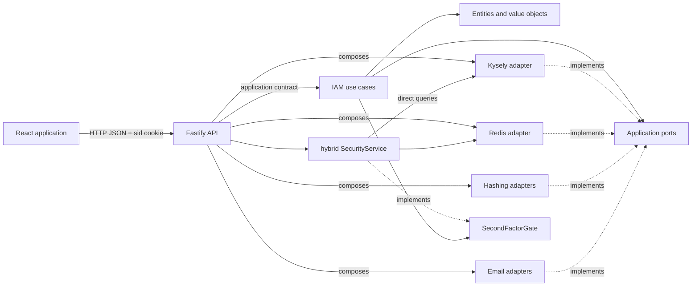

# Architecture overview

This document describes the architecture currently implemented in the
repository. Durable target constraints are owned by
[Architecture principles](../project/architecture-principles.md), and changes
follow the [delivery pipeline](../project/delivery-pipeline.md). Historical
exceptions described here are not implicit templates for new features.

## Project purpose

Architecture Web is a reference identity-management application: sign-up,
sign-in, email verification, profile, administration, sessions, recovery, MFA,
auditing, export, and account deletion. The IAM package keeps its rules
independent from Fastify, React, PostgreSQL, Redis, and email providers. The
newer security vertical is orchestrated in the API and is a documented
exception to this separation.

The repository uses a modular architecture inspired by ports and adapters. No
dependency-injection framework is used: implementations are assembled
explicitly inside the API.

The bounded context is named **IAM** (`Identity and Access Management`). Its
core package is split into three internal capabilities:

- `accounts`: account, email address, verification, and password;
- `authentication`: sign-in, resolution, and personal sessions;
- `access-administration`: paginated consultation, global indicators, roles,
  lifecycle, and administered sessions.

`apps/api/src/security` adds recovery, MFA, audit, configuration, export, and
deletion across those capabilities. Account status (`active`, `suspended`, or
`pending_deletion`) remains independent from email verification.

## Monorepo map

Every direct child of `packages/` is a workspace package root. Cohesive bounded-
context packages keep their domain and application layers below `src/`; technical
adapters and repository tooling use separate direct package roots.

```text
apps/
├── api/                                      HTTP interface and composition
└── web/                                      React interface
packages/
├── audit/                                    Audit domain + application
│   └── src/{domain,application}/
├── audit-persistence-kysely/                 Audit PostgreSQL persistence
├── delivery-automation/                      private delivery tooling
├── eslint-config/                            shared ESLint rules
├── foundation/                               modelling primitives
├── iam/                                      IAM domain + application
│   └── src/{domain,application}/
├── iam-email-nodemailer/                     Nodemailer email adapter
├── iam-email-postmark/                       Postmark email adapter
├── iam-email-verification-sha256/            verification-token hashing
├── iam-password-argon2/                      Argon2 password hashing
├── iam-password-bcrypt/                      bcrypt password hashing
├── iam-persistence-kysely/                   IAM PostgreSQL persistence
├── iam-session-redis/                        sessions and rate limiting
├── messaging/                                Messaging domain + application
│   └── src/{domain,application}/
├── messaging-persistence-kysely/             PostgreSQL outbox persistence
├── notifications/                            Notifications domain + application
│   └── src/{domain,application}/
├── notifications-delivery-nodemailer/        SMTP notification delivery
├── notifications-delivery-slack-webhook/     Slack webhook delivery
├── notifications-delivery-sms-webhook/       SMS webhook delivery
├── notifications-persistence-kysely/         Notifications PostgreSQL persistence
└── notifications-recipient-iam-kysely/       IAM-backed recipient directory
```

Package names and public exports are owned by their manifests. Physical package
roots no longer encode a nested `core`/`infrastructure` workspace hierarchy;
architectural responsibility remains expressed by package ownership, internal
`src/domain` and `src/application` layers where applicable, and dependency
rules.

## Main flow



A request reaches a Fastify route. The controller maps HTTP data to a use-case
input. The use case validates and orchestrates the domain and calls ports only.
Technical adapters implement those ports. A presenter maps the application
`Result` to an HTTP status and body. Routes under `apps/api/src/security` use a
second path: they call `SecurityService` directly, and that service uses Kysely
and maps `SecurityError` at the HTTP boundary.

## Intended properties

- IAM rules remain testable without network or database access.
- A technical provider can be replaced at the composition point.
- Business and HTTP contracts are explicit and evolve separately.
- The domain controls the creation and validity of its values.
- Expected errors are typed values; unexpected failures remain exceptions
  handled at the HTTP boundary.

## Aggregates and consistency

Foundation defines `AggregateRoot` as a semantic specialization of `Entity`.
The IAM bounded context declares three single-entity aggregates:

- `UserEntity` for identity, credentials, role, and status;
- `SessionEntity` for the lifecycle of a Redis session;
- `EmailVerificationEntity` for a verification token and its state.

Aggregates reference each other by identifier and are not loaded as a `User`
object graph. Commands that change `UserEntity` and
`EmailVerificationEntity` in PostgreSQL use `IamUnitOfWork`, implemented by a
Kysely transaction. Session creation and enforcement of the per-user limit are
atomic in Redis.

IAM aggregates now record Domain Events. PostgreSQL adapters translate them
into integration events and place them in an outbox within the IAM
transaction. A worker delivers them to the Audit and Notifications bounded
contexts with retries and idempotent consumption.

Email containing the plain verification token deliberately remains in the
post-commit application flow and is not placed in the generic outbox.

## Observed trade-offs

- `packages/iam` contains domain and application in one package, with separate
  public subpath exports and internal layers below `src/`.
- The API depends on both core packages and adapters. This is intentional in the
  composition root, where concrete details must be known.
- HTTP contracts (`*.http.ts`, `*.route-options.ts`) are separate from
  application contracts (`*.contracts.ts`). This adds files but prevents HTTP
  from becoming the business contract.
- Architecture ESLint rules are currently warnings limited to parent imports.
  Some boundaries therefore rely on documented convention and review.
- `SecurityService` mixes application orchestration and technical access inside
  `apps/api`. No ADR establishes whether this exception is durable.
- The configuration catalog contains represented but unused options. The
  [security guide](../guides/account-security.md) separates effective settings
  from visible-only settings.
