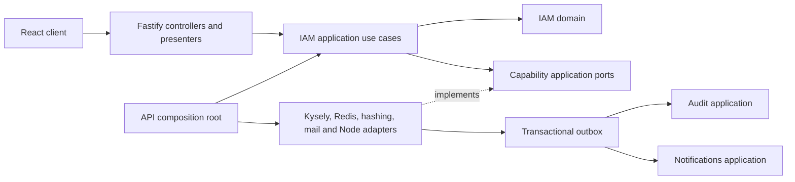

# Architecture overview

This document describes the implemented architecture. See [Architecture principles](../project/architecture-principles.md), [Dependency rules](dependency-rules.md), and [IAM security](iam-security.md) for responsibilities and consistency guarantees.

## Workspace and composition

Architecture Web is a modular identity-management reference application. Workspace discovery groups actual packages by responsibility:

```text
apps/{api,web}/
packages/
  contexts/{iam,audit,messaging,notifications}/
  adapters/<context>/<technology>/
  shared/foundation/
  tooling/{eslint-config,delivery-automation}/
```

Package manifests and public exports define boundaries; directory grouping does not grant access to another context's internals. Domain/application packages expose separate public subpaths and keep their layers under `src/`. The physical grouping diverges from the accepted flat topology recorded in ADR-0007. No accepted successor is recorded; this current-state description does not change that decision.

The API composition root explicitly instantiates adapters, initializes configuration, and calls the single `createIam` application factory. No dependency-injection framework or service locator is involved. HTTP controllers call application contracts and map results to transport responses.



## IAM capabilities

- `accounts`: registration, identities, verification, passwords, recovery, export and deletion;
- `authentication`: sign-in, MFA, reauthentication, session issuance, resolution and management;
- `access-administration`: account administration and security-configuration administration.

The `IamApplication` contract exposes `accounts`, `authentication` and `administration` capability interfaces, with 16, 13 and 12 operations respectively. `administration` represents the existing `access-administration` capability. All operations retain their individual input, output and expected-failure contracts.

Application-owned ports live near their capabilities. Shared aggregate command/query repositories and PostgreSQL transaction contracts remain explicit. There is no generic IAM `application/services` directory or API `SecurityService`.

Pure password requirements, policy selection and lifecycle predicates belong to the domain. Configuration retrieval, external password checks, and workflow coordination remain separate application responsibilities. Audit, Messaging and Notifications are autonomous contexts connected through public contracts.

## Aggregate and consistency boundaries

IAM has five existing aggregate roots:

- `UserEntity`: account status, role and session version;
- `LoginIdentityEntity`: account lookup identifiers and verification state;
- `PasswordAuthenticatorEntity`: password derivative and authenticator lifecycle;
- `EmailVerificationEntity`: a token targeting one login identity;
- `SessionEntity`: session lifecycle in Redis.

They reference each other by identifier. [ADR-0004](decisions/0004-aggregates-and-consistency.md), [ADR-0005](decisions/0005-domain-events-messaging.md), and [ADR-0006](decisions/0006-iam-account-identities-and-authenticators.md) explain these boundaries.

PostgreSQL transactions coordinate account, authenticator, identity, recovery, MFA and operation-specific state. Recovery, MFA, configuration, export and deletion adapters provide explicit atomic capabilities rather than exposing Kysely to application code. Their durable events are appended to the transaction's outbox.

Redis session creation enforces the ten-session maximum atomically. Password replacement and relevant security changes increment the PostgreSQL account's session version before Redis cleanup; resolution rejects a stale version. PostgreSQL, Redis, Audit operations and SMTP do not form a distributed transaction.

## Verification limits

ESLint enforces targeted IAM domain/application and API transport boundaries. TypeScript, package exports, tests and review cover the remaining contracts. Restrictions are deliberately narrower than the complete normative matrix.

Unit and HTTP suites cover policies, expected failures, dependency failures and controller ownership. An opt-in PostgreSQL/Redis suite covers important transaction races; its presence does not establish successful execution in an environment where Docker is unavailable. See [Testing](../development/testing.md).

Remote compromise checking, password history, exhaustive notification scenarios and deployment scheduling are not implemented by this refactoring.

## Source delivery

[ADR-0008](decisions/0008-main-only-automatic-releases.md) defines the accepted target of coordinated source releases from the sole permanent `main` branch. The repository implements release tooling for tag-owned versions and stamped source archives; the history-preserving transition and live publication activation require separate verification. The [delivery policy](../project/delivery-pipeline.md) distinguishes automatic publication from Work review and deployment.
