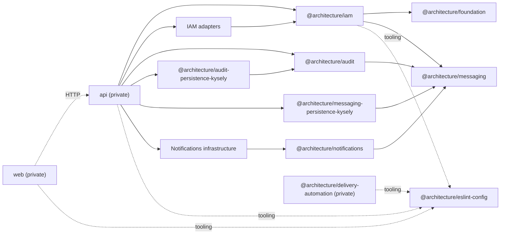

# Packages and public APIs

## Package graph

Workspace packages are grouped under `packages/contexts/*`, `packages/adapters/*/*`, `packages/shared/*`, and `packages/tooling/*`. Domain/application layers remain below each context package's `src/`. Package names and exports remain the concrete boundary.

## Catalog

| Package                                              | Responsibility                        | Public API                                                                 |
| ---------------------------------------------------- | ------------------------------------- | -------------------------------------------------------------------------- |
| `@architecture/foundation`                           | generic domain primitives             | root export                                                                |
| `@architecture/iam`                                  | IAM domain and application            | `./domain`, `./application`                                                |
| `@architecture/messaging`                            | Messaging domain and application      | `./domain`, `./application`                                                |
| `@architecture/messaging-persistence-kysely`         | PostgreSQL outbox and migration       | root export                                                                |
| `@architecture/audit`                                | Audit domain and application          | `./domain`, `./application`                                                |
| `@architecture/audit-persistence-kysely`             | Audit PostgreSQL persistence          | root export                                                                |
| `@architecture/notifications`                        | Notifications domain and application  | `./domain`, `./application`                                                |
| `@architecture/notifications-persistence-kysely`     | Notifications PostgreSQL persistence  | root export                                                                |
| `@architecture/notifications-delivery-nodemailer`    | SMTP notification delivery            | root export                                                                |
| `@architecture/notifications-delivery-slack-webhook` | Slack webhook delivery                | root export                                                                |
| `@architecture/notifications-delivery-sms-webhook`   | SMS webhook delivery                  | root export                                                                |
| `@architecture/notifications-recipient-iam-kysely`   | IAM recipient directory               | root export                                                                |
| `@architecture/iam-persistence-kysely`               | IAM PostgreSQL schema and persistence | root export                                                                |
| `@architecture/iam-session-redis`                    | sessions and rate limiting            | root export                                                                |
| `@architecture/iam-password-argon2`                  | selected password hashing             | root export                                                                |
| `@architecture/iam-password-bcrypt`                  | alternative implementation            | root export                                                                |
| `@architecture/iam-email-verification-sha256`        | token hashing                         | `main`/`types`, no `exports` field                                         |
| `@architecture/iam-email-nodemailer`                 | selected SMTP delivery                | root export                                                                |
| `@architecture/iam-email-postmark`                   | alternative provider                  | root export                                                                |
| `@architecture/eslint-config`                        | shared ESLint configurations          | `.`, `node`, `react-vite`, `architecture`, `iam`, `api-boundaries`, `full` |
| `@architecture/delivery-automation`                  | repository delivery tooling           | private                                                                    |
| `api`                                                | server and composition                | private                                                                    |
| `web`                                                | React client                          | private                                                                    |

Each package manifest remains the source of truth. Bcrypt and Postmark adapters
are tested alternatives, but the current composition selects Argon2 and
Nodemailer. `@architecture/delivery-automation` is private repository tooling;
it is a workspace package but not a product/runtime public API.

## Ports and selected implementations

| Application port                 | Composed implementation                               |
| -------------------------------- | ----------------------------------------------------- |
| `UserRepository`                 | `KyselyUserAdapter`                                   |
| `EmailVerificationRepository`    | `KyselyEmailVerificationAdapter`                      |
| `SessionRepository`              | `RedisSessionAdapter`                                 |
| `EmailVerificationRateLimiter`   | `RedisEmailVerificationRateLimitAdapter`              |
| `PasswordHasher`                 | `Argon2PasswordHasherAdapter`                         |
| `EmailVerificationTokenHasher`   | `Sha256EmailVerificationTokenHasherAdapter`           |
| `VerificationEmailSender`        | `NodemailerEmailSenderAdapter`                        |
| `PasswordPolicyReader`           | `PublishedIamPolicies` or `FixedPasswordPolicyReader` |
| `ConfigurationStore`             | `KyselySecurityConfigurationAdapter`                  |
| `PasswordRecoveryStore`          | `KyselyPasswordRecoveryAdapter`                       |
| `MfaStore`                       | `KyselyMfaAdapter`                                    |
| `AccountExportStore`             | `KyselyAccountExportAdapter`                          |
| `AccountDeletionStore`           | `KyselyAccountDeletionAdapter`                        |
| `OutboxWriter`                   | `KyselyOutboxWriterAdapter`                           |
| `OutboxRepository`               | `KyselyOutboxRepositoryAdapter`                       |
| `AuditRepository`                | `KyselyAuditRepositoryAdapter`                        |
| `NotificationRepository`         | `KyselyNotificationRepositoryAdapter`                 |
| `NotificationRecipientDirectory` | `KyselyIamNotificationRecipientDirectoryAdapter`      |
| `NotificationDelivery` (email)   | `NodemailerNotificationDeliveryAdapter`               |
| `NotificationDelivery` (Slack)   | `SlackWebhookNotificationDeliveryAdapter`             |
| `NotificationDelivery` (SMS)     | `SmsWebhookNotificationDeliveryAdapter`               |

`BcryptPasswordHasherAdapter` and `PostmarkEmailSenderAdapter` also satisfy
`PasswordHasher` and `VerificationEmailSender`.

`UserQueryRepository.search` is the only user-collection read. It requires a bounded
page and page size, then returns the entity page and filtered total.
`getAdministrationOverview` provides global indicators separately.
`SessionRepository.findActiveForUser` remains unpaginated because
`SignInUseCase` limits an account to 10 active sessions.

## Persistence

PostgreSQL stores users, verifications, recoveries, MFA settings, backup codes,
challenges, audits, notifications, deliveries, the outbox, configuration
revisions, exports, and deletion requests. IAM Kysely migrations live in
`packages/adapters/iam/persistence-kysely/src/persistence/migrations`; Messaging, Audit,
and Notifications migrations live respectively in
`packages/adapters/messaging/persistence-kysely`, `packages/adapters/audit/persistence-kysely`, and
`packages/adapters/notifications/persistence-kysely`.
Redis stores expiring sessions, a per-user sorted set, and resend rate limits.

Application use cases own security orchestration; capability adapters own SQL and atomic operations. Audit owns its own persistence. See [IAM security](iam-security.md).

Schema, migrations, and mappers **MUST** evolve together. Rehydrated entities
**MUST** still satisfy their value objects; invalid persisted data must not be
silently normalized.

## Versioning and publication

[ADR-0008](decisions/0008-main-only-automatic-releases.md) adopts one coordinated
project version. Tracked manifests declare development baseline `0.1.0` after the
explicit migration from `1.0.0-alpha.1`; published `vX.Y.Z` tags own released
versions. The attached source archive stamps every workspace manifest and
preserves `workspace:*`. No independent package or registry publication is active.
HTTP contract `v1` remains independent from project SemVer. See the
[delivery policy](../project/delivery-pipeline.md) and [release guide](../development/releases.md).

## Authorized IAM contract migration

For the IAM correction, the maintainer explicitly authorized these replacements: `EmailSender` → `VerificationEmailSender`; `PasswordPolicyValidator` → `PasswordValidation` with an explicitly supplied policy; `SecondFactorGate` → `BeginSecondFactorUseCase` application contract; and `IamPolicyProvider`/`PasswordPolicyProvider` → narrow capability and operation-scoped readers. `IamActorRole`/`IamAccountIdentityPolicy`/`IamCapability` consumers must use the corresponding explicit role, account-policy and capability contracts rather than importing the removed universal provider vocabulary.

`createIam` callers supply one `IamDependencies` contract containing explicit repositories, checks, outbound ports and outbox, with the existing account, authentication, session, password and recovery reader contracts combined through `policies`. Operation-aware readers retain registration, sign-in and account-security projections. Second-factor handling and shared application coordination are constructed internally. Adapter implementers must support conditional credential-use recording, identity replacement that preserves administration, and administrative-access queries through `UserQueryRepository`. The unit of work provides transaction-bound `userQueries`; `UserRepository` remains limited to account aggregate commands/loads. All in-repository implementations and doubles are migrated together. This is a targeted source-contract migration, not a new package publication or SemVer policy. Package identities and public subpaths remain unchanged.

The application composition API exposes only `createIam`, returning `IamApplication.accounts`, `.authentication` and `.administration` through the public `AccountsApplication`, `AuthenticationApplication` and `AdministrationApplication` interfaces. Consumers migrate flat calls such as `iam.signIn` to `iam.authentication.signIn`, and former security calls such as `security.requestRecovery` to `iam.accounts.requestRecovery`. The `createIamSecurity`, `IamSecurityApplication` and `IamSecurityDependencies` composition exports are removed; there is no compatibility facade. Individual operation contracts, public package subpaths, HTTP contracts and persistence semantics are preserved.

Direct construction of administration use cases now requires an explicit `AdministratorAuthorizer`. Account-administration operations that only used the user repository for authorization receive this authorizer instead; session-administration operations retain their repository and receive the authorizer separately. `createIam` shares one instance across account and configuration administration. Constructors do not construct a fallback authorizer.

MFA challenge creation additionally requires the expected account session generation, while status consultation keeps its original input. Fresh-authentication results carry that generation to the configuration commit guard. These are explicit application contracts; they do not expose credentials or introduce a persistence framework into the core.

## Event processing contracts

`OutboxRepository.claim()` returns one `OutboxClaim` or null. Its immutable
`claimToken` accompanies the message through `finalize(claim)`, which returns
false after ownership loss. `recoverStale()` uses PostgreSQL time. Attempts count
at claim, including abandoned attempts. The former batch claim and unconditional
save/release methods are removed.

`NotificationRepository.claimDelivery()` similarly returns one
`ClaimedNotificationDelivery` or null. `finalizeDelivery(claim)` updates only that
delivery and returns false after ownership loss. `saveState(notification)` writes
acknowledgement/archive state only; `recoverStaleDeliveries()` handles abandoned
attempts. The former combined save and batch claim contracts are removed.

Notification creation uses `hasConsumedEvent(sourceEventId)` and
`createForEvent(sourceEventId, notifications)` instead of single-notification
`create`. The latter accepts the complete aggregate set, including an empty
selection, and atomically records consumption with its effects. A consumed
event is a no-op; failure persists none of the set. Recipients appear once and
all aggregates belong to the supplied source event. The precheck is advisory;
the adapter must enforce concurrent idempotency. See
[Atomic Notifications consumption](iam-events-reliability.md#atomic-notifications-consumption)
for the approved target and rationale.

IAM application exports `createIamSecurityEvent` and its closed
`IamSecurityEventInput` contract for existing application/security facts.
Aggregate facts use `toIamIntegrationEvent` with explicit payload projections.
Session-started's only current integration version is v2; other existing topics
retain v1. Incompatible versions are rejected before consumer effects.

These source-contract replacements have no compatibility facade. Schemas include
claim tokens at creation; the selected fresh-database target requires no upgrade
of existing outbox/delivery rows. See [Event reliability](iam-events-reliability.md).
