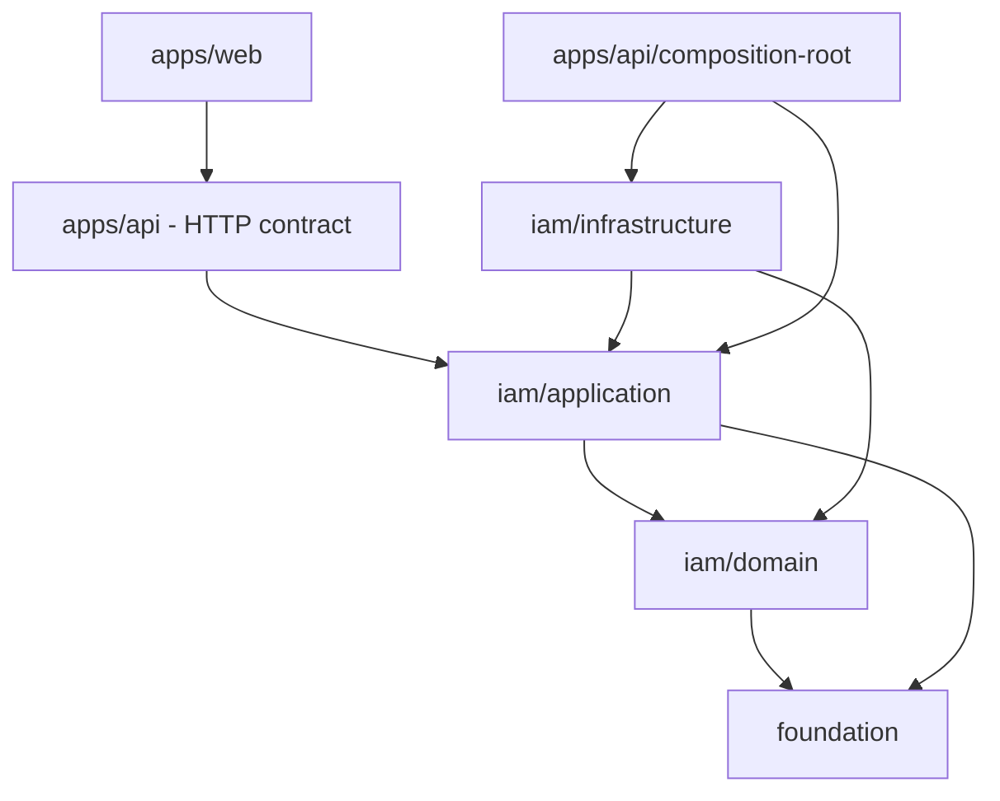

# Dependency rules

**MUST**, **MUST NOT**, **SHOULD**, and **MAY** are normative.

## Allowed direction



An arrow means “may depend on”; it does not require the dependency.

## Matrix

| From                    | May import                                  | Must not import                             |
| ----------------------- | ------------------------------------------- | ------------------------------------------- |
| Foundation              | required generic libraries                  | IAM, apps, infrastructure                   |
| IAM domain              | Foundation, IAM domain                      | application, infrastructure, Fastify, React |
| IAM application         | IAM domain, Foundation, local ports         | adapters, database, cache, HTTP, UI         |
| IAM infrastructure      | public IAM exports, targeted technology     | private core internals, apps                |
| API outside composition | application contracts, Fastify, API helpers | domain internals, concrete adapters         |
| API composition root    | application and concrete adapters           | —                                           |
| Web                     | UI code and HTTP contract                   | business and infrastructure packages        |

`apps/api/src/security/security.service.ts` is a current exception to the
“API outside composition” row: it imports Kysely, domain objects, and adapter
types. The matrix describes the rule followed by `features/iam`, not a
guarantee enforced across all of `apps/api`. This exception **MUST NOT** be
copied without an explicit architectural decision.

## Direct answers

- An entity **MUST NOT** import a use case.
- A use case **MUST NOT** depend on Redis or Kysely.
- Infrastructure **MUST** depend on the application port it implements.
- Business types shared by domain and application belong to the domain.
- Generic, truly cross-domain types **MAY** belong to Foundation.
- HTTP DTOs belong to `apps/api`; matching client types belong to `apps/web`.
- Business packages **MAY** depend on Foundation, but applications and adapters
  **SHOULD** prefer a closer contract when one exists.

## Exports and imports

External consumers **MUST** use exported subpaths:

```ts
import type { SignIn } from "@architecture/iam/application";
import { EmailValueObject } from "@architecture/iam/domain";
```

They **MUST NOT** import files inside
`packages/iam/core/application/<capability>/use-cases`. Within a package, declared
`#...` aliases **SHOULD** replace `../` parent imports. The current ESLint rule
reports parent imports as warnings.

Internal core aliases omit `.js`; relative imports intended for ESM output
generally include `.js`.

## Port compatibility

An implementation **MUST**:

1. depend on the public port;
2. declare `implements Port`;
3. preserve semantics as well as the signature;
4. test important behavior and technical errors;
5. be selected only in the composition root.

Adding a required method, changing parameters, return values, or semantics is a
breaking port change. Every adapter and test double **MUST** change together.
Adding a required contract field, removing a code, or changing its meaning is
also breaking.

## Current enforcement and limitation

pnpm packages, `exports`, and TypeScript types materialize boundaries. ESLint
does not yet forbid every dependency direction. The matrix remains normative
for the core and historical IAM features even when tooling does not block a
violation. The `apps/api/src/security` vertical demonstrates that the
convention can currently be bypassed.
