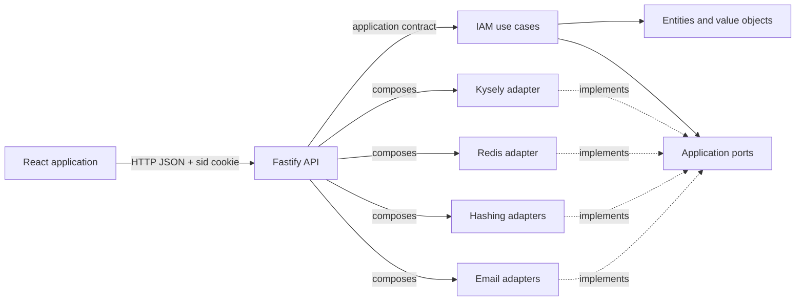

# Architecture overview

## Project purpose

Architecture Web is a reference identity-management application: sign-up,
sign-in, email verification, profile, user administration, and session
management. Its architectural goal is to keep business rules independent from
Fastify, React, PostgreSQL, Redis, and email providers.

The repository uses a modular architecture inspired by ports and adapters. No
dependency-injection framework is used: implementations are assembled
explicitly inside the API.

The bounded context is named **IAM** (`Identity and Access Management`) and is
split into three internal capabilities:

- `accounts`: account, email address, verification, and password;
- `authentication`: sign-in, resolution, and personal sessions;
- `access-administration`: paginated consultation, global indicators, roles,
  lifecycle, and administered sessions.

Account status (`active` or `suspended`) is independent from email
verification. There is no `pending` status.

## Monorepo map

```text
apps/
├── api/                         HTTP interface and composition
└── web/                         React interface
packages/
├── foundation/                  modelling primitives
├── eslint-config/               shared ESLint rules
└── iam/
    ├── core/                    domain + application
    └── infrastructure/
        ├── email/               Nodemailer and Postmark
        ├── persitence/kysely/   PostgreSQL through Kysely
        ├── security/            Argon2, bcrypt, and SHA-256
        └── session/redis/       sessions and rate limiting
```

The `persitence` directory contains a historical spelling error, while the
published package is correctly named
`@architecture/iam-persistence-kysely`. Documentation uses the real path
when linking to code.

## Main flow



A request reaches a Fastify route. The controller maps HTTP data to a use-case
input. The use case validates and orchestrates the domain and calls ports only.
Technical adapters implement those ports. A presenter maps the application
`Result` to an HTTP status and body.

## Intended properties

- IAM rules remain testable without network or database access.
- A technical provider can be replaced at the composition point.
- Business and HTTP contracts are explicit and evolve separately.
- The domain controls the creation and validity of its values.
- Expected errors are typed values; unexpected failures remain exceptions
  handled at the HTTP boundary.

## Concepts not modelled

The current code defines no event bus, domain events, aggregate-root class, or
separate domain services. `UserEntity`, `SessionEntity`, and
`EmailVerificationEntity` are entities, but no explicit aggregate root exists.
These concepts must not be assumed until a decision and implementation
introduce them.

## Observed trade-offs

- `packages/iam/core` contains domain and application in one package, with
  separate public subpath exports.
- The API depends on both core and adapters. This is intentional in the
  composition root, where concrete details must be known.
- HTTP contracts (`*.http.ts`, `*.route-options.ts`) are separate from
  application contracts (`*.contracts.ts`). This adds files but prevents HTTP
  from becoming the business contract.
- Architecture ESLint rules are currently warnings limited to parent imports.
  Some boundaries therefore rely on documented convention and review.
