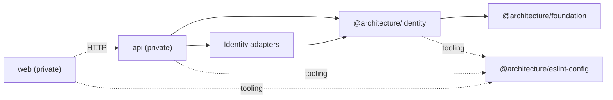

# Packages and public APIs

## Package graph

## Catalog

| Package                                            | Responsibility                              | Public API                                        |
| -------------------------------------------------- | ------------------------------------------- | ------------------------------------------------- |
| `@architecture/foundation`                         | generic domain primitives                   | root export                                       |
| `@architecture/identity`                           | Identity domain and application             | `./domain`, `./application`                       |
| `@architecture/identity-persistence-kysely`        | PostgreSQL users, verifications, and schema | root export                                       |
| `@architecture/identity-session-redis`             | sessions and rate limiting                  | root export                                       |
| `@architecture/identity-password-argon2`           | selected password hashing                   | root export                                       |
| `@architecture/identity-password-bcrypt`           | alternative implementation                  | root export                                       |
| `@architecture/identity-email-verification-sha256` | token hashing                               | `main`/`types`, no `exports` field                |
| `@architecture/identity-email-nodemailer`          | selected SMTP delivery                      | root export                                       |
| `@architecture/identity-email-postmark`            | alternative provider                        | root export                                       |
| `@architecture/eslint-config`                      | shared ESLint configurations                | `.`, `node`, `react-vite`, `architecture`, `full` |
| `api`                                              | server and composition                      | private                                           |
| `web`                                              | React client                                | private                                           |

Each package manifest remains the source of truth. Bcrypt and Postmark adapters
are tested alternatives, but the current composition selects Argon2 and
Nodemailer.

## Ports and selected implementations

| Application port                  | Composed implementation                     |
| --------------------------------- | ------------------------------------------- |
| `UserAdministrationRepository`    | `KyselyUserAdapter`                         |
| `EmailVerificationRepository`     | `KyselyEmailVerificationAdapter`            |
| `SessionAdministrationRepository` | `RedisSessionAdapter`                       |
| `EmailVerificationRateLimiter`    | `RedisEmailVerificationRateLimitAdapter`    |
| `PasswordHasher`                  | `Argon2PasswordHasherAdapter`               |
| `EmailVerificationTokenHasher`    | `Sha256EmailVerificationTokenHasherAdapter` |
| `EmailSender`                     | `NodemailerEmailSenderAdapter`              |

`BcryptPasswordHasherAdapter` and `PostmarkEmailSenderAdapter` also satisfy
`PasswordHasher` and `EmailSender`.

## Persistence

PostgreSQL stores users and email verifications. Kysely migrations live in
`packages/identity/infrastructure/persitence/kysely/src/persistence/migrations`.
Redis stores expiring sessions, a per-user sorted set, and resend rate limits.

Schema, migrations, and mappers **MUST** evolve together. Rehydrated entities
**MUST** still satisfy their value objects; invalid persisted data must not be
silently normalized.

## Versioning and publication

Packages currently share version `1.0.0-alpha.1`, but the repository contains
neither Semantic Release configuration nor evidence of independent versioning.
Most packages use `prepublishOnly` to build. Any stronger publication or SemVer
policy needs a human decision and an ADR.
