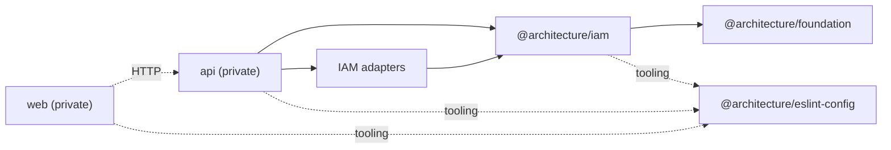

# Packages and public APIs

## Package graph

## Catalog

| Package                                       | Responsibility                        | Public API                                        |
| --------------------------------------------- | ------------------------------------- | ------------------------------------------------- |
| `@architecture/foundation`                    | generic domain primitives             | root export                                       |
| `@architecture/iam`                           | IAM domain and application            | `./domain`, `./application`                       |
| `@architecture/iam-persistence-kysely`        | IAM PostgreSQL schema and persistence | root export                                       |
| `@architecture/iam-session-redis`             | sessions and rate limiting            | root export                                       |
| `@architecture/iam-password-argon2`           | selected password hashing             | root export                                       |
| `@architecture/iam-password-bcrypt`           | alternative implementation            | root export                                       |
| `@architecture/iam-email-verification-sha256` | token hashing                         | `main`/`types`, no `exports` field                |
| `@architecture/iam-email-nodemailer`          | selected SMTP delivery                | root export                                       |
| `@architecture/iam-email-postmark`            | alternative provider                  | root export                                       |
| `@architecture/eslint-config`                 | shared ESLint configurations          | `.`, `node`, `react-vite`, `architecture`, `full` |
| `api`                                         | server and composition                | private                                           |
| `web`                                         | React client                          | private                                           |

Each package manifest remains the source of truth. Bcrypt and Postmark adapters
are tested alternatives, but the current composition selects Argon2 and
Nodemailer.

## Ports and selected implementations

| Application port               | Composed implementation                     |
| ------------------------------ | ------------------------------------------- |
| `UserRepository`               | `KyselyUserAdapter`                         |
| `EmailVerificationRepository`  | `KyselyEmailVerificationAdapter`            |
| `SessionRepository`            | `RedisSessionAdapter`                       |
| `EmailVerificationRateLimiter` | `RedisEmailVerificationRateLimitAdapter`    |
| `PasswordHasher`               | `Argon2PasswordHasherAdapter`               |
| `EmailVerificationTokenHasher` | `Sha256EmailVerificationTokenHasherAdapter` |
| `EmailSender`                  | `NodemailerEmailSenderAdapter`              |
| `SecondFactorGate`             | `SecurityService` in `apps/api`             |

`BcryptPasswordHasherAdapter` and `PostmarkEmailSenderAdapter` also satisfy
`PasswordHasher` and `EmailSender`.

`UserRepository.search` is the only user-collection read. It requires a bounded
page and page size, then returns the entity page and filtered total.
`getAdministrationOverview` provides global indicators separately.
`SessionRepository.findActiveForUser` remains unpaginated because
`SignInUseCase` limits an account to 10 active sessions.

## Persistence

PostgreSQL stores users, verifications, recoveries, MFA settings, backup codes,
challenges, audits, configuration revisions, exports, and deletion requests.
Kysely migrations live in
`packages/iam/infrastructure/persitence/kysely/src/persistence/migrations`.
Redis stores expiring sessions, a per-user sorted set, and resend rate limits.

Tables introduced by `003_create_iam_security` are queried directly by
`SecurityService`; they have no dedicated repository or mapper in the Kysely
package. The package exports their TypeScript schema and migration, not a
complete security adapter.

Schema, migrations, and mappers **MUST** evolve together. Rehydrated entities
**MUST** still satisfy their value objects; invalid persisted data must not be
silently normalized.

## Versioning and publication

Packages currently share version `1.0.0-alpha.1`, but the repository contains
neither Semantic Release configuration nor evidence of independent versioning.
Most packages use `prepublishOnly` to build. Any stronger publication or SemVer
policy needs a human decision and an ADR.
