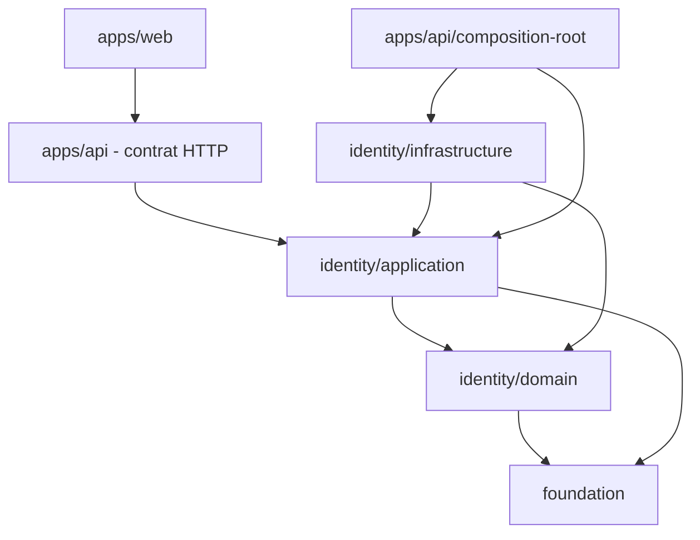

# Règles de dépendance

Les termes **DOIT**, **NE DOIT PAS**, **DEVRAIT** et **PEUT** sont normatifs.

## Direction autorisée



Une flèche signifie « peut dépendre de ». Elle n’impose pas qu’une dépendance
existe.

## Matrice

| Depuis                  | Peut importer                                | Ne peut pas importer                        |
| ----------------------- | -------------------------------------------- | ------------------------------------------- |
| Foundation              | bibliothèques génériques nécessaires         | Identity, applications, infrastructure      |
| Identity domain         | Foundation, domaine Identity                 | application, infrastructure, Fastify, React |
| Identity application    | domaine Identity, Foundation, ports locaux   | adaptateurs, base, cache, HTTP, UI          |
| Infrastructure Identity | exports publics Identity, technologie ciblée | internes privés du cœur, applications       |
| API hors composition    | contrats applicatifs, Fastify, helpers API   | internals du domaine, adaptateur concret    |
| API composition root    | application et adaptateurs concrets          | —                                           |
| Web                     | son code UI et le contrat HTTP               | packages métier et infrastructure           |

## Réponses aux questions fréquentes

- Une entité **NE DOIT PAS** importer un cas d’utilisation.
- Un cas d’utilisation **NE DOIT PAS** dépendre de Redis ou Kysely.
- Une infrastructure **DOIT** dépendre du port applicatif qu’elle implémente.
- Les types métier partagés par domaine et application appartiennent au domaine.
- Les types génériques et réellement transverses **PEUVENT** appartenir à
  Foundation.
- Les DTO HTTP appartiennent à `apps/api`; les types de client correspondants
  appartiennent à `apps/web`.
- Tous les packages métier **PEUVENT** dépendre de Foundation, mais une
  application ou un adaptateur **DEVRAIT** éviter cette dépendance lorsqu’un
  contrat plus proche suffit.

## Exports et imports

Un consommateur externe **DOIT** utiliser les sous-chemins exportés :

```ts
import type { SignIn } from "@architecture/identity/application";
import { EmailValueObject } from "@architecture/identity/domain";
```

Il **NE DOIT PAS** importer un fichier interne de
`packages/identity/core/application/use-cases`. À l’intérieur d’un package, les
alias `#...` déclarés dans son `package.json` **DEVRAIENT** être utilisés pour
éviter les remontées `../`. La règle ESLint actuelle signale ces remontées avec
un avertissement.

Les extensions suivent la résolution utilisée par le package : les fichiers
source internes du cœur emploient les alias `#...` sans `.js`, tandis que les
imports relatifs destinés à la sortie ESM emploient généralement `.js`.

## Compatibilité d’un port

Une implémentation **DOIT** :

1. dépendre du port public ;
2. déclarer `implements Port` ;
3. préserver la sémantique, pas seulement la signature ;
4. avoir des tests ciblant les cas importants et les erreurs techniques ;
5. être sélectionnée uniquement dans le composition root.

Ajouter une méthode obligatoire, modifier ses paramètres ou sa sémantique, ou
modifier une valeur de retour constitue un changement cassant du port. Tous les
adaptateurs et doubles de test concernés **DOIVENT** évoluer dans le même
changement. Ajouter un champ obligatoire à un contrat, retirer un code ou
modifier sa signification est également cassant.

## Contrôle actuel et limite

Les frontières de packages sont matérialisées par pnpm, `exports` et les types
TypeScript. ESLint n’interdit toutefois pas encore toutes les directions de
dépendance. La matrice ci-dessus est donc normative même lorsqu’aucun outil ne
la bloque automatiquement.
