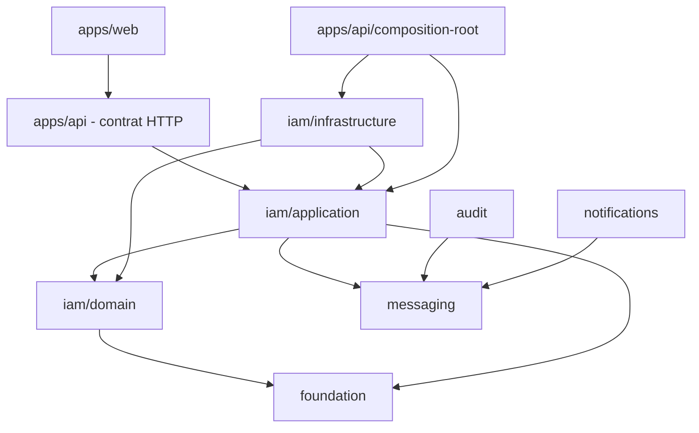

# Règles de dépendance

Les termes **DOIT**, **NE DOIT PAS**, **DEVRAIT** et **PEUT** sont normatifs.

## Direction autorisée



Une flèche signifie « peut dépendre de ». Elle n’impose pas qu’une dépendance
existe.

## Matrice

| Depuis               | Peut importer                                    | Ne peut pas importer                        |
| -------------------- | ------------------------------------------------ | ------------------------------------------- |
| Foundation           | bibliothèques génériques nécessaires             | IAM, applications, infrastructure           |
| IAM domain           | Foundation, domaine IAM                          | application, infrastructure, Fastify, React |
| IAM application      | domaine IAM, Foundation, Messaging, ports locaux | adaptateurs, base, cache, HTTP, UI          |
| Audit                | Messaging, ses ports et son modèle               | entités internes IAM, HTTP, UI              |
| Notifications        | Messaging, ses ports et son modèle               | entités internes IAM, HTTP, UI              |
| Infrastructure IAM   | exports publics IAM, technologie ciblée          | internes privés du cœur, applications       |
| API hors composition | contrats applicatifs, Fastify, helpers API       | internals du domaine, adaptateur concret    |
| API composition root | application et adaptateurs concrets              | —                                           |
| Web                  | son code UI et le contrat HTTP                   | packages métier et infrastructure           |

`apps/api/src/security/security.service.ts` est une exception actuelle à la
ligne « API hors composition » : il importe Kysely, des objets du domaine et
des types d’adaptateurs. La matrice exprime la règle suivie par
`features/iam`, pas une garantie automatiquement respectée par tout
`apps/api`. Cette exception ne **DOIT PAS** être copiée sans décision
architecturale explicite.

## Réponses aux questions fréquentes

- Une entité **NE DOIT PAS** importer un cas d’utilisation.
- Un cas d’utilisation **NE DOIT PAS** dépendre de Redis ou Kysely.
- Une infrastructure **DOIT** dépendre du port applicatif qu’elle implémente.
- Un repository de commande **DOIT** recevoir et sauvegarder une racine
  d’agrégat.
- Une transaction couvrant plusieurs agrégats **DOIT** être pilotée par un port
  applicatif, jamais directement par Kysely dans le cas d’utilisation.
- Les types métier partagés par domaine et application appartiennent au domaine.
- Les types génériques et réellement transverses **PEUVENT** appartenir à
  Foundation.
- Les DTO HTTP appartiennent à `apps/api`; les types de client correspondants
  appartiennent à `apps/web`.
- Tous les packages métier **PEUVENT** dépendre de Foundation, mais une
  application ou un adaptateur **DEVRAIT** éviter cette dépendance lorsqu’un
  contrat plus proche suffit.

## Exports et imports

Un consommateur externe **DOIT** utiliser les sous-chemins exportés :

```ts
import type { SignIn } from "@architecture/iam/application";
import { EmailValueObject } from "@architecture/iam/domain";
```

Il **NE DOIT PAS** importer un fichier interne de
`packages/iam/core/application/<capacité>/use-cases`. À l’intérieur d’un package, les
alias `#...` déclarés dans son `package.json` **DEVRAIENT** être utilisés pour
éviter les remontées `../`. La règle ESLint actuelle signale ces remontées avec
un avertissement.

Les extensions suivent la résolution utilisée par le package : les fichiers
source internes du cœur emploient les alias `#...` sans `.js`, tandis que les
imports relatifs destinés à la sortie ESM emploient généralement `.js`.

## Compatibilité d’un port

Une implémentation **DOIT** :

1. dépendre du port public ;
2. déclarer `implements Port` ;
3. préserver la sémantique, pas seulement la signature ;
4. avoir des tests ciblant les cas importants et les erreurs techniques ;
5. être sélectionnée uniquement dans le composition root.

Ajouter une méthode obligatoire, modifier ses paramètres ou sa sémantique, ou
modifier une valeur de retour constitue un changement cassant du port. Tous les
adaptateurs et doubles de test concernés **DOIVENT** évoluer dans le même
changement. Ajouter un champ obligatoire à un contrat, retirer un code ou
modifier sa signification est également cassant.

## Contrôle actuel et limite

Les frontières de packages sont matérialisées par pnpm, `exports` et les types
TypeScript. ESLint n’interdit toutefois pas encore toutes les directions de
dépendance. La matrice ci-dessus est donc normative pour le cœur et les
fonctionnalités IAM historiques même lorsqu’aucun outil ne la bloque
automatiquement. La verticale `apps/api/src/security` montre que cette
convention peut actuellement être contournée.
