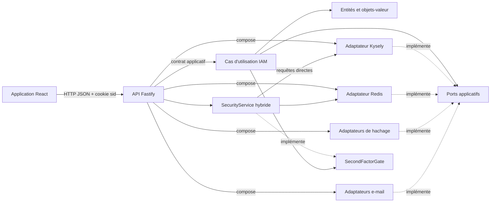

# Vue d’ensemble de l’architecture

## But du projet

Architecture Web est une application de référence pour la gestion d’identité :
inscription, connexion, vérification d’adresse électronique, profil,
administration, sessions, récupération, MFA, audit, export et suppression de
compte. Le cœur IAM historique conserve ses règles indépendantes de Fastify,
React, PostgreSQL, Redis et des fournisseurs d’e-mail. La verticale de sécurité
récente est toutefois orchestrée dans l’API et constitue une exception
documentée à cette séparation.

Le dépôt applique une architecture modulaire inspirée des ports et adaptateurs.
Le code n’emploie pas de framework d’injection de dépendances : les
implémentations sont assemblées explicitement dans l’API.

Le bounded context porte le nom **IAM** (`Identity and Access Management`). Son
cœur se divise en trois capacités internes :

- `accounts` : compte, adresse électronique, vérification et mot de passe ;
- `authentication` : connexion, résolution et sessions personnelles ;
- `access-administration` : consultation paginée, indicateurs globaux, rôles,
  cycle de vie et sessions administrées.

Le module `apps/api/src/security` ajoute transversalement récupération, MFA,
audit, configuration, export et suppression. Le statut du compte (`active`,
`suspended` ou `pending_deletion`) reste indépendant de la vérification de
l’adresse électronique.

## Carte du monorepo

```text
apps/
├── api/                         interface HTTP et composition
└── web/                         interface React
packages/
├── foundation/                  primitives de modélisation
├── eslint-config/               règles ESLint partagées
└── iam/
    ├── core/                    domaine + application
    └── infrastructure/
        ├── email/               Nodemailer et Postmark
        ├── persitence/kysely/   PostgreSQL via Kysely
        ├── security/            Argon2, bcrypt et SHA-256
        └── session/redis/       sessions et limitation de débit
```

Le nom de dossier `persitence` contient une faute historique, mais il s’agit
bien du package publié sous le nom
`@architecture/iam-persistence-kysely`. La documentation utilise le chemin
réel lorsqu’elle pointe vers le code.

## Flux principal



Une requête arrive dans une route Fastify. Le contrôleur traduit les données
HTTP vers l’entrée du cas d’utilisation. Le cas d’utilisation valide et
orchestre le domaine, puis appelle uniquement des ports. Les adaptateurs
techniques implémentent ces ports. Un presenter transforme enfin le
`Result` applicatif en statut et corps HTTP. Les routes de
`apps/api/src/security` suivent un second chemin : elles appellent directement
`SecurityService`, qui utilise Kysely et traduit ses `SecurityError` à la
frontière HTTP.

## Propriétés recherchées

- Les règles d’identité restent testables sans réseau ni base de données.
- Un fournisseur technique peut être remplacé au point de composition.
- Les contrats métier et HTTP sont explicites et évoluent séparément.
- Le domaine contrôle la création et la validité de ses valeurs.
- Les erreurs attendues sont des valeurs typées ; les défaillances inattendues
  restent des exceptions gérées à la frontière HTTP.

## Agrégats et cohérence

Foundation définit `AggregateRoot` comme spécialisation sémantique d’`Entity`.
Le bounded context IAM déclare trois agrégats unitaires :

- `UserEntity`, pour l’identité, les credentials, le rôle et le statut ;
- `SessionEntity`, pour le cycle de vie d’une session Redis ;
- `EmailVerificationEntity`, pour un jeton de vérification et son état.

Les agrégats se référencent par identifiant et ne sont pas chargés comme un
graphe `User`. Les commandes qui modifient `UserEntity` et
`EmailVerificationEntity` dans PostgreSQL utilisent `IamUnitOfWork`, implémenté
par une transaction Kysely. La création d’une session et l’application de la
limite par utilisateur sont atomiques dans Redis.

Le code ne définit toujours ni bus d’événements, ni événements de domaine, ni
service de domaine distinct. L’envoi d’e-mail a lieu après le commit
PostgreSQL, mais aucun outbox durable ne permet encore de le réessayer après
une défaillance SMTP.

## Compromis observés

- `packages/iam/core` regroupe domaine et application dans un même package,
  tout en leur donnant deux points d’export distincts.
- L’API dépend à la fois du cœur et des adaptateurs : c’est volontaire au
  niveau du composition root, où les détails doivent être connus.
- Les contrats HTTP (`*.http.ts`, `*.route-options.ts`) sont distincts des
  contrats applicatifs (`*.contracts.ts`). Cela augmente le nombre de fichiers,
  mais empêche le protocole HTTP de devenir le contrat métier.
- Les règles ESLint d’architecture sont actuellement des avertissements limités
  aux imports parents. Une part des frontières reste donc une convention
  documentée et revue humainement.
- `SecurityService` mélange orchestration applicative et accès technique dans
  `apps/api`. Aucun ADR n’établit encore si cette exception est durable.
- Le catalogue de configuration contient des options représentées mais non
  consommées ; le [guide de sécurité](../guides/account-security.md) distingue
  les valeurs effectives des valeurs seulement visibles.
