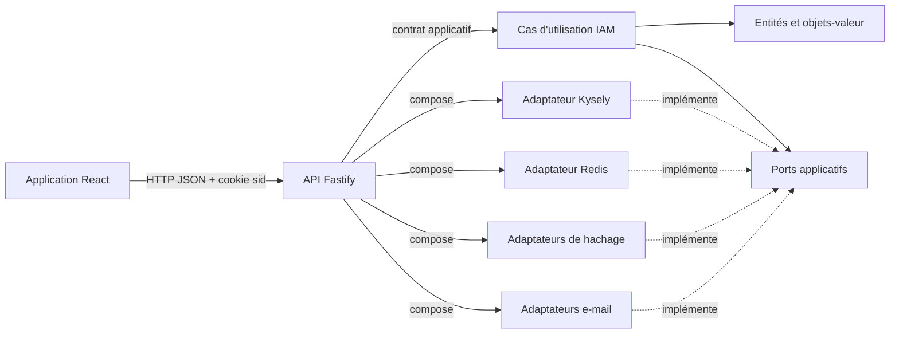

# Vue d’ensemble de l’architecture

## But du projet

Architecture Web est une application de référence pour la gestion d’identité :
inscription, connexion, vérification d’adresse électronique, profil,
administration des utilisateurs et gestion des sessions. Son intérêt
architectural est de conserver les règles métier indépendantes de Fastify,
React, PostgreSQL, Redis et des fournisseurs d’e-mail.

Le dépôt applique une architecture modulaire inspirée des ports et adaptateurs.
Le code n’emploie pas de framework d’injection de dépendances : les
implémentations sont assemblées explicitement dans l’API.

Le bounded context porte le nom **IAM** (`Identity and Access Management`) et
se divise en trois capacités internes :

- `accounts` : compte, adresse électronique, vérification et mot de passe ;
- `authentication` : connexion, résolution et sessions personnelles ;
- `access-administration` : consultation paginée, indicateurs globaux, rôles,
  cycle de vie et sessions administrées.

Le statut du compte (`active` ou `suspended`) est indépendant de la vérification
de l’adresse électronique. Aucun statut `pending` n’existe.

## Carte du monorepo

```text
apps/
├── api/                         interface HTTP et composition
└── web/                         interface React
packages/
├── foundation/                  primitives de modélisation
├── eslint-config/               règles ESLint partagées
└── iam/
    ├── core/                    domaine + application
    └── infrastructure/
        ├── email/               Nodemailer et Postmark
        ├── persitence/kysely/   PostgreSQL via Kysely
        ├── security/            Argon2, bcrypt et SHA-256
        └── session/redis/       sessions et limitation de débit
```

Le nom de dossier `persitence` contient une faute historique, mais il s’agit
bien du package publié sous le nom
`@architecture/iam-persistence-kysely`. La documentation utilise le chemin
réel lorsqu’elle pointe vers le code.

## Flux principal



Une requête arrive dans une route Fastify. Le contrôleur traduit les données
HTTP vers l’entrée du cas d’utilisation. Le cas d’utilisation valide et
orchestre le domaine, puis appelle uniquement des ports. Les adaptateurs
techniques implémentent ces ports. Un presenter transforme enfin le
`Result` applicatif en statut et corps HTTP.

## Propriétés recherchées

- Les règles d’identité restent testables sans réseau ni base de données.
- Un fournisseur technique peut être remplacé au point de composition.
- Les contrats métier et HTTP sont explicites et évoluent séparément.
- Le domaine contrôle la création et la validité de ses valeurs.
- Les erreurs attendues sont des valeurs typées ; les défaillances inattendues
  restent des exceptions gérées à la frontière HTTP.

## Ce que l’architecture ne modélise pas

Le code actuel ne définit ni bus d’événements, ni événements de domaine, ni
classe d’agrégat, ni service de domaine distinct. `UserEntity`,
`SessionEntity` et `EmailVerificationEntity` sont des entités, mais aucune
racine d’agrégat explicite n’est déclarée. Ces concepts ne doivent pas être
présumés tant qu’une décision et une implémentation ne les introduisent pas.

## Compromis observés

- `packages/iam/core` regroupe domaine et application dans un même package,
  tout en leur donnant deux points d’export distincts.
- L’API dépend à la fois du cœur et des adaptateurs : c’est volontaire au
  niveau du composition root, où les détails doivent être connus.
- Les contrats HTTP (`*.http.ts`, `*.route-options.ts`) sont distincts des
  contrats applicatifs (`*.contracts.ts`). Cela augmente le nombre de fichiers,
  mais empêche le protocole HTTP de devenir le contrat métier.
- Les règles ESLint d’architecture sont actuellement des avertissements limités
  aux imports parents. Une part des frontières reste donc une convention
  documentée et revue humainement.
