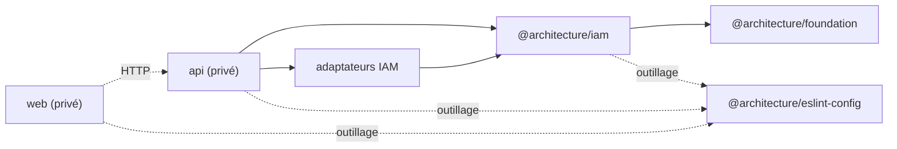

# Packages et API publiques

## Graphe des packages

## Catalogue

| Package                                       | Responsabilité                                   | API publique                                      |
| --------------------------------------------- | ------------------------------------------------ | ------------------------------------------------- |
| `@architecture/foundation`                    | primitives génériques du domaine                 | export racine                                     |
| `@architecture/iam`                           | domaine et application IAM                       | `./domain`, `./application`                       |
| `@architecture/iam-persistence-kysely`        | utilisateurs, vérifications et schéma PostgreSQL | export racine                                     |
| `@architecture/iam-session-redis`             | sessions et limitation de débit                  | export racine                                     |
| `@architecture/iam-password-argon2`           | hachage de mot de passe sélectionné              | export racine                                     |
| `@architecture/iam-password-bcrypt`           | implémentation alternative                       | export racine                                     |
| `@architecture/iam-email-verification-sha256` | hachage des jetons                               | `main`/`types`, sans champ `exports`              |
| `@architecture/iam-email-nodemailer`          | envoi SMTP sélectionné                           | export racine                                     |
| `@architecture/iam-email-postmark`            | fournisseur alternatif                           | export racine                                     |
| `@architecture/eslint-config`                 | configurations ESLint partagées                  | `.`, `node`, `react-vite`, `architecture`, `full` |
| `api`                                         | serveur et composition                           | privé, non publié                                 |
| `web`                                         | client React                                     | privé, non publié                                 |

Le `package.json` de chaque package reste la source de vérité. Les adaptateurs
alternatifs bcrypt et Postmark sont testés mais ne sont pas sélectionnés par le
composition root actuel, qui utilise Argon2 et Nodemailer.

## Ports et implémentations actuelles

| Port applicatif                | Implémentation composée                     |
| ------------------------------ | ------------------------------------------- |
| `UserRepository`               | `KyselyUserAdapter`                         |
| `EmailVerificationRepository`  | `KyselyEmailVerificationAdapter`            |
| `SessionRepository`            | `RedisSessionAdapter`                       |
| `EmailVerificationRateLimiter` | `RedisEmailVerificationRateLimitAdapter`    |
| `PasswordHasher`               | `Argon2PasswordHasherAdapter`               |
| `EmailVerificationTokenHasher` | `Sha256EmailVerificationTokenHasherAdapter` |
| `EmailSender`                  | `NodemailerEmailSenderAdapter`              |

Les variantes `BcryptPasswordHasherAdapter` et
`PostmarkEmailSenderAdapter` satisfont respectivement `PasswordHasher` et
`EmailSender`.

`UserRepository.search` est la seule lecture de collection d’utilisateurs. Elle
exige une page et une taille bornée, puis retourne la page d’entités et le total
filtré. `getAdministrationOverview` fournit séparément les indicateurs globaux.
`SessionRepository.findActiveForUser` reste non paginé parce que
`SignInUseCase` limite un compte à 10 sessions actives.

## Persistance

PostgreSQL conserve les utilisateurs et les vérifications d’e-mail. Les
migrations Kysely sont dans
`packages/iam/infrastructure/persitence/kysely/src/persistence/migrations`.
Redis conserve les sessions avec expiration et un ensemble trié par
utilisateur, ainsi que la limitation des renvois de vérification.

Le schéma, les migrations et les mappers **DOIVENT** évoluer ensemble. Une
entité réhydratée **DOIT** encore satisfaire ses objets-valeur ; les données
invalides ne doivent pas être normalisées silencieusement.

## Versionnage et publication

Les packages portent actuellement la même version `1.0.0-alpha.1`, mais le
dépôt ne contient ni configuration Semantic Release ni politique prouvant un
versionnage indépendant. Les champs `prepublishOnly` construisent la plupart
des packages. Toute règle de publication ou de compatibilité SemVer au-delà de
ce constat nécessite une décision humaine et un ADR.
